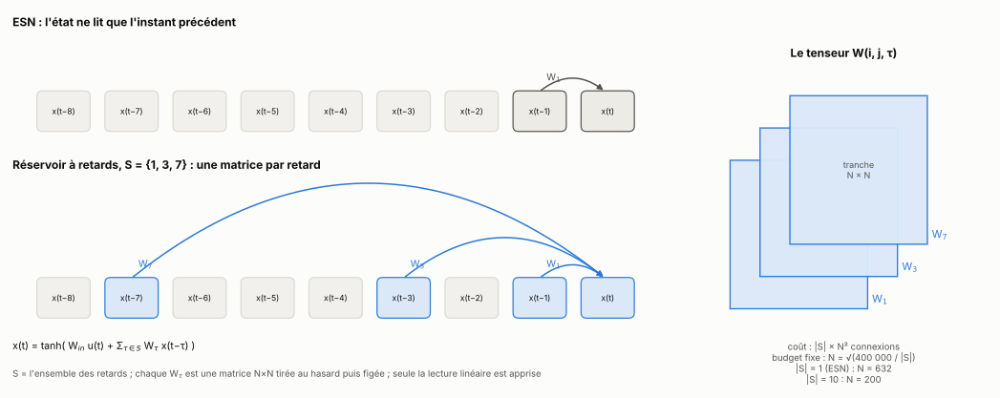
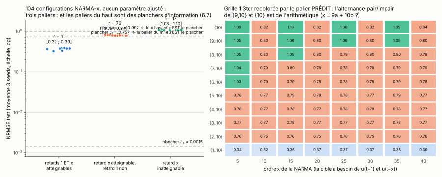
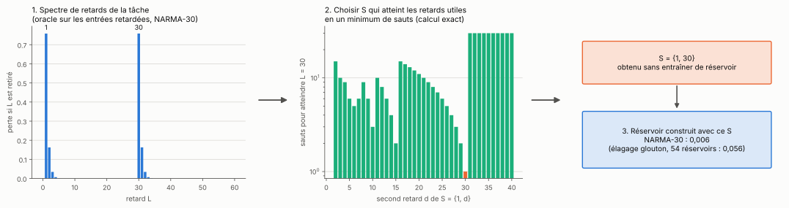
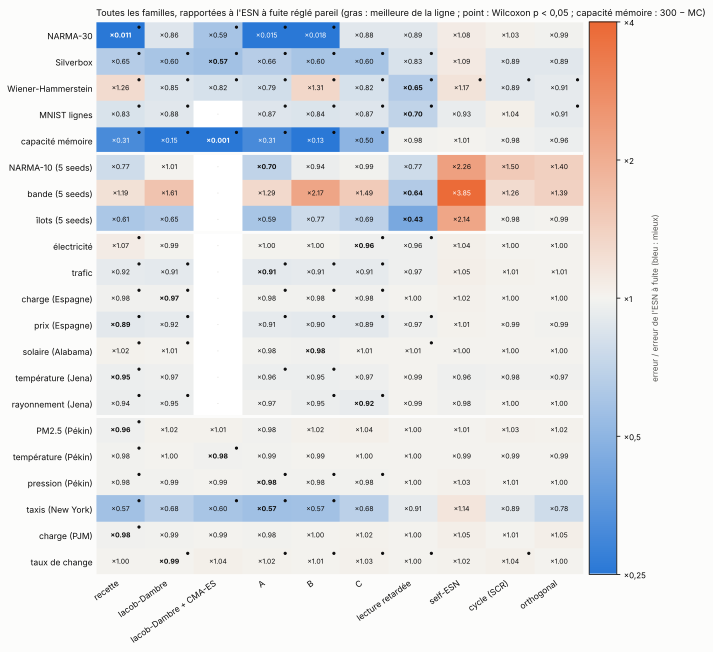
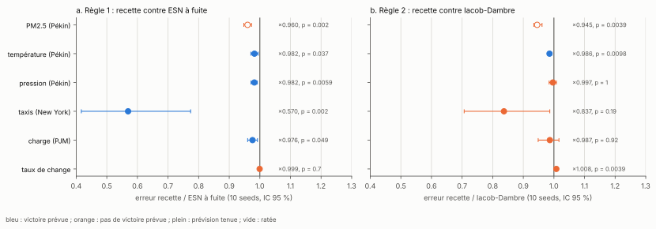
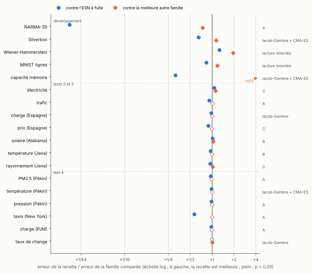

# delay-tensor-esn

*Un Echo State Network dont l'état lit directement plusieurs instants passés, chacun par sa propre matrice. Quels retards choisir, pourquoi, et ce que ça vaut à budget égal.*

[](.github/workflows/tests.yml)

Dans un **ESN**, l'état suit x(t) = tanh(W_in·u(t) + W·x(t − 1)) : la matrice récurrente ne voit que l'instant précédent, et une entrée ancienne ne survit qu'à travers une longue chaîne de multiplications qui l'efface. Ici, chaque retard τ d'un ensemble S a sa propre matrice W_τ :

```
x(t) = tanh( W_in·u(t) + Σ_{τ ∈ S} W_τ·x(t − τ) )
```

S = {1} redonne un ESN ; S = {1, 30} lit l'instant précédent et celui de 30 pas plus tôt. Les comparaisons se font toujours à nombre de connexions récurrentes égal (400 000 : un ESN de 632 neurones, ou 200 neurones avec dix retards), et seule la lecture linéaire est entraînée. Toute l'étude porte sur le choix de S.



## En bref

> **En une phrase : S fixe exactement quels âges de l'entrée l'état peut contenir, et ça suffit à calculer S à partir des données sans aucune recherche. Sur 13 séries réelles neuves, le S calculé bat l'ESN à fuite 10 fois, et la prévision écrite avant le calcul est tenue 10 fois. Mais il ne bat nettement des délais sans calcul (Iacob et Dambre, 2024) que là où l'âge utile est long et isolé, et un ridge sur les mêmes âges, sans réservoir, fait souvent aussi bien.**

- **Une règle exacte, et sa réciproque** (partie 2) : x(t) ne peut contenir u(t − L) que si L est une somme d'éléments de S, et, pour presque tous les poids, il contient bien chacun de ces âges. Les 104 configurations NARMA mesurées se rangent en trois paliers, qui sont exactement des planchers d'information. Une borne démontrée relie la sensibilité à un âge au nombre minimal de sauts pour l'atteindre.

  

- **S se calcule** (partie 3) : on mesure sans réservoir quels âges de l'entrée comptent, puis on prend le S qui les atteint en un minimum de sauts. Sur NARMA-30, ça donne {1, 30} : 9 fois mieux que l'élagage glouton, et zéro réservoir entraîné pour le trouver. La recette complète fait 0,0042, le meilleur réservoir de l'étude sur cette tâche.

  

- **À réglage égal** (partie 4), le réservoir à retards avec fuite bat l'ESN à fuite sur les cinq tâches de développement. Contre une dizaine d'autres façons de placer un retard (délais de propagation, lecture retardée, self-ESN, cycle…), la recette n'est la meilleure que sur NARMA-30, où elle reste 54 fois devant Iacob-Dambre optimisé par CMA-ES. Sur Wiener-Hammerstein et MNIST, le même S donne de meilleurs résultats en lecture retardée qu'en connexions.

  

- **Sur des séries neuves** (partie 5), avec la prévision écrite et poussée avant tout calcul. Le premier diagnostic (âge par âge, 4 séries) a raté ce qui comptait ; le diagnostic par périodes, sur 13 séries en trois tests :
  - **contre l'ESN à fuite**, la recette gagne sur 10 séries, de −2 % à −43 %, et la prévision est tenue 10 fois sur 13 ;
  - **contre Iacob et Dambre**, une règle écrite avant le test 4 (la recette gagne si la période utile dépasse leur portée) est tenue 5 fois sur 6 ;
  - **un ridge linéaire sur 200 âges**, sans réservoir, bat tous les réservoirs sur 4 des 6 séries du test 4.

  

- **Sur un réservoir physique à un nœud** (partie 6), la même règle dit où il perd le tour précédent, et un compte de décalages, sans simulation, dit où sa mémoire s'effondre.



## Le rapport

| | Partie | Contenu | Schéma |
|---|---|---|---|
| 0 | [Le modèle et le protocole](rapport/0_modele.md) | le modèle, S, budget égal, tâches, protocole | [schéma](results/schemas/schema_modele.svg) |
| 1 | [Où les retards gagnent](rapport/1_ou_ca_gagne.md) | une vingtaine de tâches, NARMA-x, quels retards garder | [schéma](results/schemas/schema_structure.svg) |
| 2 | [La règle des âges atteignables](rapport/2_regle.md) | semi-groupe engendré par S, réciproque, borne par les sauts, planchers, entrées lisses, champ moyen | [schéma](results/schemas/schema_atteignables.svg) |
| 3 | [Calculer S](rapport/3_calculer_S.md) | spectre de retards, sauts, réglage égal, terme produit, la recette | [schéma](results/schemas/schema_recette.svg) |
| 4 | [Contre les références](rapport/4_comparaisons.md) | tranches gratuites, entrées retardées, NG-RC, réglage équitable, budgets, Iacob et Dambre, autres places pour un retard | [schéma](results/schemas/schema_familles.svg) |
| 5 | [Séries neuves, prévisions écrites avant](rapport/5_series_reelles.md) | quatre tests pré-enregistrés, 17 séries réelles | [schéma](results/schemas/schema_reel.svg) |
| 6 | [Un réservoir physique](rapport/6_reservoir_physique.md) | un nœud, des boucles de retard, résonances | [schéma](results/schemas/schema_reservoir_physique.svg) |
| 7 | [Bilan](rapport/7_bilan.md) | ce qui marche, ce qui ne marche pas, position par rapport à l'existant, la suite | [figure](results/bilan_final.svg) |
| | [Références](rapport/references.md) · [Reproduire](rapport/reproduire.md) · [Pré-enregistrements](rapport/preenregistrements/README.md) · [Fausses pistes](fausses-pistes/README.md) | | |

Chaque partie commence par son schéma et par « ce qu'il faut retenir », et se termine par le même bilan (où ça marche, les limites, le lien avec la théorie) et par ses références.

## Position par rapport à l'existant

Le plus proche est Iacob et Dambre (2024), un ESN à fuite avec une matrice creuse par délai de propagation, comparé ici à budget et réglage égaux, avec leurs positions optimisées par CMA-ES (parties 4.6 et 5.6). Le critère « nombre minimal de sauts » existe pour les RNN entraînés (recurrent skip coefficient de Zhang et al., 2016 ; mean recurrent length des Dilated RNN, Chang et al., 2017), motivé par le gradient et sans borne. La règle des sommes elle-même est élémentaire (longueurs de chemins dans un graphe). Ce qui est propre à ce travail : les planchers d'information qu'elle prévoit, la borne de sensibilité par les sauts, le calcul de S sans réservoir, et sa validation pré-enregistrée sur des séries neuves. Détail dans le [bilan](rapport/7_bilan.md#position-par-rapport-à-lexistant).

## Reproduire

```bash
pip install -r requirements.txt pytest
pytest                          # vérifications du moteur, de la théorie et des références (une seconde)
python src/schemas.py           # tous les schémas pédagogiques
python src/plot_figures.py      # théorie, test 4, carte des références, bilan
python src/plot_reel.py         # tests 1 à 3
python src/plot_iacob.py        # Iacob et Dambre
python src/reel_v4.py tableau   # un tableau, relu depuis results/
```

Toutes les figures se refont à partir des résultats enregistrés dans `results/`, sans relancer de simulation. Les commandes de calcul, partie par partie, sont dans [rapport/reproduire.md](rapport/reproduire.md).

## Organisation

```
delay-tensor-esn/
├── README.md            # cette page
├── rapport/             # le rapport, un fichier par partie, et les pré-enregistrements
├── src/                 # simulations, figures, schémas (un script par expérience)
├── tests/               # vérifications (pytest, version réduite)
├── results/             # résultats (JSON), figures, schémas (results/schemas/)
└── fausses-pistes/      # essais qui n'ont rien donné, et pourquoi
```
