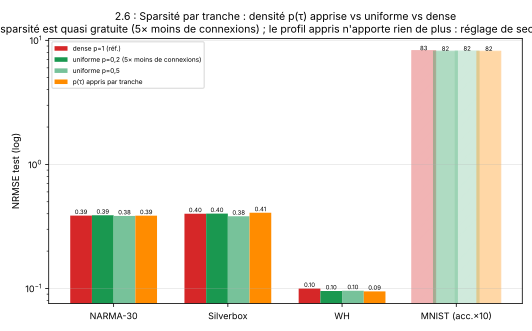
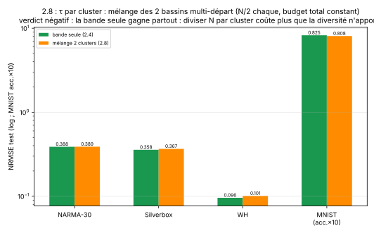
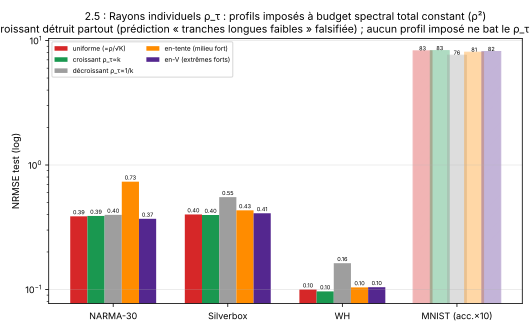
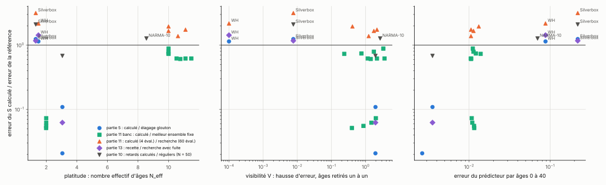
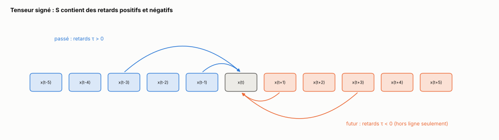

[Sommaire](../README.md#le-rapport)

# Fausses pistes

Ce dossier garde les essais qui n'ont rien donné, qui ne départagent pas les modèles ou qui sortent du sujet, avec la raison. Rien ici n'est utilisé par les conclusions du [rapport](../README.md). Les chiffres sont des moyennes sur 3 seeds sauf mention contraire.

## 1. Tâches qui ne départagent pas

- **Mackey-Glass à un pas** (retards 17 et 50) : NRMSE entre 5·10⁻⁴ et 8·10⁻⁴ pour tous les modèles. La limite vient de la lecture, pas du réservoir.
- **Lorenz-63 à un pas** : 0,104 ± 0,12 pour l'ESN, 0,69 ± 0,84 pour le réservoir à dix retards. Les écarts-types dépassent les moyennes : la métrique est dominée par quelques pas où la prédiction diverge.
- **Hénon à cinq pas** : 0,855 à 0,963 pour tous, à la limite de prédictibilité.
- **Parité L = 2 avec D ≥ 20, et L = 6 pour tout D** : tous les modèles au hasard (1,02 à 1,04), y compris avec le terme produit de la partie 3.

## 2. Densité apprise par tranche

Chaque tranche reçoit une densité p(τ) ∈ {0,2 ; 0,5 ; 1}, apprise par descente de coordonnées sur la validation (masques emboîtés). Retirer 80 % des connexions ne change presque rien : à p = 0,2 partout, NARMA-30 0,389, Silverbox 0,401, WH 0,095, MNIST 81,8 %, contre 0,387, 0,400, 0,100 et 82,6 % en dense. La densité apprise par tranche ne fait pas mieux que la densité uniforme (0,386, 0,408, 0,095, 81,7 %).

## 3. Deux sous-réservoirs avec deux bandes de retards

N = 200 coupé en deux sous-réservoirs indépendants de 100 neurones, chacun avec une des deux bandes trouvées par la recherche continue (partie 1). À budget constant, jamais mieux que la bande seule : NARMA 0,389 contre 0,388, Silverbox 0,367 contre 0,358, WH 0,101 contre 0,096, MNIST 80,8 % contre 82,5 %. Diviser le réservoir coûte plus que la diversité des bandes ne rapporte.

## 4. Atténuer les retards longs

Profils d'échelle s(τ) ∝ e^(−τ/τ₀) ou 1/τ sur les dix tranches : NARMA-30 de 0,43 à 0,73, Silverbox 0,54, WH 0,14, MNIST 74 %. Affaiblir les retards longs ramène la mémoire vers les âges récents, comme un ESN. Même chose en imposant un profil de rayons à masse constante (Σ ρ_τ² = ρ²) : le profil décroissant dégrade toutes les tâches (Silverbox 0,552 contre 0,400, WH 0,163 contre 0,100, MNIST 76,3 % contre 82,6 %), le profil central détruit NARMA (0,734), et aucun profil imposé ne fait mieux que les gains appris.

## 5. Deux passes couplées par un état commun, récurrence à un seul pas

Première version du bidirectionnel couplé (fausse piste 12) : chaque direction n'avait qu'une récurrence à un pas, x(t ∓ 1), et les retards multiples n'entraient que dans l'état commun. NARMA-30 0,41 à 0,42 : le niveau du réservoir uniforme, loin de 0,051. Sans retard long dans la récurrence, aucune entrée ancienne n'est atteinte en peu de sauts. La version avec retards dans chaque direction fait 0,18.

## 6. Gains des tranches choisis par le profil de champ moyen

Répartir le rayon spectral entre les tranches pour maximiser la séparation de l'âge le moins bien séparé (champ moyen, partie 2) met toute la masse sur la tranche τ = 1, pour toutes les tâches. Le réservoir obtenu est un ESN plus petit : 0,75 sur NARMA-30, pire que l'ESN sur les deux NARMA.

## 7. Un seuil d'énergie pour le croisement ESN contre retards

La formule x\* = ln θ / (2 ln ρ), θ = 10⁻², donnait 21,9 à ρ = 0,9, proche du croisement mesuré. Aux autres rayons, elle donne 6,5 à 44,9 quand le croisement mesuré reste entre 17,9 et 24,1 (10 seeds, ESN contre {1, …, 10} au même ρ). Le seuil θ nécessaire varie d'un facteur 400 et dépend de N.

## 8. Choisir S, la fuite et ρ par le profil de mémoire

Prendre, parmi 640 configurations, celle dont le profil de mémoire linéarisé recouvre le mieux l'enveloppe des âges utiles de la tâche (entrées lisses, partie 2). C'est la pire des six méthodes de conception sur les six tâches testées : 0,403 sur un noyau en bande contre 0,166 pour S calculé par les sauts, 0,797 sur Silverbox contre 0,350 pour {1, …, 10}. Le score de recouvrement n'est corrélé à l'erreur qu'avec un rang de −0,04 à −0,37. Le profil dit où va la mémoire linéaire, pas ce que la lecture en extrait.

## 9. Plusieurs boucles d'un réservoir physique avec des gains β/√K

Première campagne du réservoir physique (partie 6) : K boucles de gains β/√K, la normalisation des tranches aléatoires. Sur un nœud unique, les gains positifs s'ajoutent, le gain de boucle Σ β_k vaut de 1,13 à 1,65 et le réservoir sature : capacité mémoire de 0,0 à 9,1 sur 60 pour toutes les familles à plusieurs boucles. La comparaison refaite avec Σ β_k = β est dans la partie 6.3.

## 10. L'erreur de l'oracle comme critère de succès du S calculé

Sur 28 comparaisons déjà faites, seule l'erreur du prédicteur par âges (l'« oracle ») semblait séparer les victoires du S calculé (oracle sous 0,014) de ses défaites (Silverbox, WH, NARMA-10, oracle de 0,07 à 0,22). Mais le S calculé y avait moins de réglage que ses adversaires (ρ seul, contre ρ, fuite et échelle d'entrée). À réglage égal (partie 3.3), la séparation disparaît : il ne perd plus sur Silverbox ni sur WH. La platitude du spectre (N_eff) et sa visibilité ne séparaient rien non plus.

## 11. Spectre de Silverbox et WH mesuré sur trop peu de signal

Sur Silverbox et WH, aucun âge seul ne pèse plus de 4·10⁻⁵ dans le spectre. Le S calculé y dépend du bruit de mesure plus que de la tâche : selon le segment et la plage d'âges utilisés, {1, 2}, {1, 4} ou {1, 12} sur Silverbox, {1, 5} ou {4, 5} sur WH, et à K = 3 un retard part parfois sur un bloc lointain ({1, 2, 57}, {1, 31, 37}), qui fait jusqu'à trois fois pire. Sur ces tâches, la recette retient {1, 12} ou {1, …, 10} parce que le réglage sur la validation tranche, pas parce que le spectre désigne un âge.

## 12. Retards négatifs, hors ligne

Hors ligne, toute la séquence est connue, et S peut contenir des retards négatifs. Trois façons de lire le futur, toujours à 400 000 connexions, 3 seeds : deux passes indépendantes (une dans chaque sens, comme un RNN bidirectionnel, Schuster et Paliwal, 1997), deux passes couplées par un état commun, et un tenseur signé x(t) = tanh(W_in u(t) + Σ_τ W₋τ x(t − τ) + W₊τ x(t + τ)), calculé comme un point fixe.

| configuration | NARMA-30 | Silverbox | WH | MNIST (précision) |
|---|---|---|---|---|
| ensemble élu, causal | **0,051** | **0,340** | **0,059** | 84,6 % |
| ensemble élu, deux passes | 0,096 | 0,403 | 0,071 | 87,1 % |
| ensemble élu, couplé | 0,179 | 0,405 | 0,092 | 87,4 % |
| ensemble élu, tenseur signé, lu en 4 points | 0,352 | 0,502 | 0,139 | **89,2 %** |

Sur les tâches causales, le futur de l'entrée n'apporte rien, et ses variables ajoutent du bruit à la lecture. Sur MNIST, qui n'a pas de sens de lecture privilégié, le tenseur signé lu en quatre points (892 variables) fait 89,2 %, contre 86,8 % pour deux passes indépendantes lues aux mêmes points (891 variables). Avec des retards positifs et négatifs, les âges atteignables forment un groupe (sommes et différences) au lieu d'un semi-groupe. C'est hors du sujet (la prévision causale) : la piste n'a pas été poursuivie.

Scripts : `src/bi_dir.py`, `src/cpl2_bidir.py`, `src/bidir_pts4.py`, `src/plot_bidir.py`.

## 13. Le réseau spatio-temporel

L'anneau de réservoirs à retards spatio-temporels (un retard devient un couple (retard, décalage de site), la règle des sommes devient un cône) a été déplacé dans l'idée 34, consacrée à la spatio-temporalité, avec ses scripts et ses résultats.

## Références

- Schuster et Paliwal, *Bidirectional recurrent neural networks*, IEEE Transactions on Signal Processing 45 (1997).
- Liste complète : [../rapport/references.md](../rapport/references.md).

---

[Sommaire](../README.md#le-rapport)
