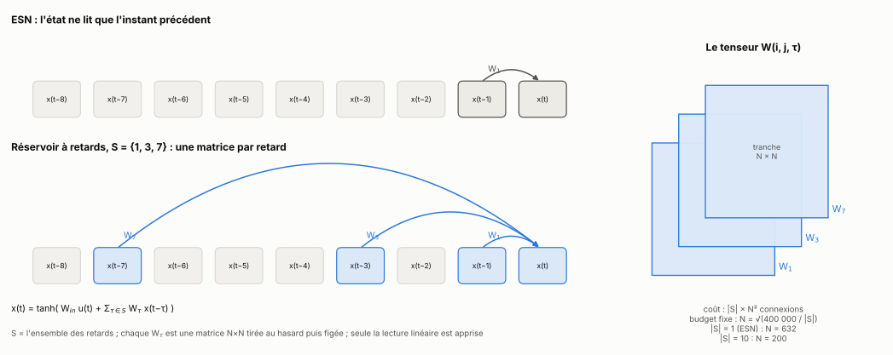

[Sommaire](../README.md#le-rapport) · [Partie 1 →](1_ou_ca_gagne.md)

# Partie 0 — Le modèle et le protocole



> **Ce qu'il faut retenir**
>
> - Le modèle est un ESN dont l'état lit plusieurs instants passés au lieu d'un seul. L'ensemble de ces retards s'appelle **S**, et chaque retard τ de S a sa propre matrice aléatoire W_τ.
> - Toutes les comparaisons se font à **nombre de connexions récurrentes égal** : plus S a de retards, plus chaque matrice est petite.
> - Seule la lecture (un ridge) est apprise. Le réservoir est tiré au hasard puis figé. Tout se règle sur une validation, jamais sur le test.

## 0.1 Le modèle

```
ESN                  x(t) = tanh( W_in·u(t) + W·x(t−1) )
réservoir à retards  x(t) = tanh( W_in·u(t) + Σ_{τ ∈ S} W_τ·x(t−τ) )
avec une fuite a     x(t) = (1 − a)·x(t−1) + a·tanh( W_in·u(t) + Σ_{τ ∈ S} W_τ·x(t−τ) )
lecture              ŷ(t) = W_out·[x(t), 1]        (seule W_out est apprise, par ridge)
```

Dans un ESN, l'entrée d'il y a 30 pas doit traverser 30 fois W pour atteindre l'état, et elle s'efface un peu à chaque passage. Ici, W est remplacée par une matrice par retard. Avec S = {1, 3, 7}, x(t) lit directement x(t − 1), x(t − 3) et x(t − 7). Empilées, ces matrices forment un tenseur W(i, j, τ) : neurone i, neurone j, retard τ.

| S | ce que c'est |
|---|---|
| {1} | l'ESN classique |
| {1, …, 10} | les dix premiers retards, le point de départ |
| {1, 2, 4, 8, 16} | puissances de 2 |
| {1, 30} | deux retards : l'instant précédent et 30 pas en arrière |

Toute l'étude porte sur une question : **quel S choisir ?**

## 0.2 Les règles du jeu

**Budget égal.** Une matrice dense N × N coûte N² connexions. Avec K = |S| tranches denses, le réservoir coûte K·N². Le budget est fixé à 400 000 connexions récurrentes, donc N = √(400 000 / K) : l'ESN a 632 neurones, le réservoir à dix retards en a 200. Même nombre de connexions, même coût par pas de temps. Quand une tranche est une permutation (partie 4), elle ne coûte rien et tout le budget va à W₁.

**Normalisation.** Chaque W_τ est gaussienne, remise à l'échelle pour que son rayon spectral (le plus grand module de ses valeurs propres) vaille ρ/√K. Le rayon global ρ se règle comme dans un ESN. Le facteur √K garde constante l'énergie totale de la mémoire, quel que soit S (partie 2.8).

**Contrôle.** Avec S = {1}, le réservoir à retards est un ESN, au chiffre près (vérifié par les tests).

## 0.3 Les tâches

| tâche | ce qu'elle demande |
|---|---|
| NARMA-x | y(t) = a·y(t−1) + b·y(t−1)·Σ_{i=1..x} y(t−i) + 1,5·u(t−1)·u(t−x) + d, avec u uniforme sur [0 ; 0,5] ; (a, b, d) = (0,2 ; 0,004 ; 0,001), sauf NARMA-10 : (0,3 ; 0,05 ; 0,1). La cible dépend du produit de l'entrée d'il y a 1 pas et de celle d'il y a x pas : x règle la profondeur de mémoire |
| capacité mémoire (MC) | reconstruire u(t−k) pour chaque k ; MC = Σ_k r²(k), jusqu'à k = 20, 40, 60 ou 300 selon l'expérience |
| Silverbox, Wiener-Hammerstein (WH) | deux circuits électroniques réels, classiques de l'identification non linéaire |
| MNIST lignes | une image lue ligne par ligne : 28 pas de 28 pixels, lecture sur l'état final |
| parité retardée | XOR de bits anciens |
| noyaux plantés | cibles construites pour avoir un spectre de retards connu (pics, bande, îlots, partie 2.7) |
| séries réelles | 17 séries jamais ouvertes pendant le développement (partie 5) |

Les erreurs sont des **NRMSE** : √(moyenne de (ŷ − y)²) / écart-type de y, sur le test. 1 veut dire « aussi bien que prédire la moyenne ». Pour MNIST, c'est le taux d'erreur ; pour la capacité mémoire, 300 − MC quand une erreur est demandée.

## 0.4 Le protocole

- Entrée [u(t), 1], W_in uniforme sur [−0,5 ; 0,5] (multipliée par l'échelle d'entrée), état nul avant t = 0.
- Tirages dans un ordre fixe pour chaque seed (W_in, puis les W_τ par τ croissant) : deux familles comparées à la même seed partagent leurs tirages, et les comparaisons sont appariées.
- Lecture ridge, λ ∈ {10⁻⁸, 10⁻⁶, 10⁻⁴, 10⁻²}.
- **Tout se règle sur la validation, jamais sur le test** : λ, ρ, fuite, échelle d'entrée, S. La validation, ce sont les 20 % finaux du bloc d'entraînement (pour la campagne de la partie 1 et les premières ablations, un segment de 500 à 2 000 pas juste avant le test). Ensuite, la lecture est réapprise sur tout le bloc.
- NARMA : 5 200 pas, les 1 000 derniers en test. Silverbox et WH : les 10 000 derniers points en test.
- 3 seeds pour la campagne de la partie 1, 5 pour la plupart des expériences, 10 pour les comparaisons de la partie 4 et les séries réelles. Test de Wilcoxon apparié : avec 10 seeds, p ne peut pas descendre sous 0,002 ; avec 5, pas sous 0,0625.

**Une limite à garder en tête.** NARMA, Silverbox, WH, MNIST et la capacité mémoire ont servi pendant tout le développement : ce ne sont pas des données vierges. La partie 5 teste donc la méthode sur des séries jamais regardées auparavant, avec la prévision écrite et poussée avant le calcul.

## 0.5 Le plan

| Partie | Ce qu'elle traite |
|---|---|
| [1](1_ou_ca_gagne.md) | où les retards gagnent, et quels retards garder |
| [2](2_regle.md) | la règle exacte des âges atteignables, sa réciproque, une borne, et combien de mémoire on a |
| [3](3_calculer_S.md) | calculer S à partir des données : la recette |
| [4](4_comparaisons.md) | contre les références, à réglage égal, dont Iacob et Dambre et les autres places pour un retard |
| [5](5_series_reelles.md) | séries neuves, prévisions écrites avant le calcul |
| [6](6_reservoir_physique.md) | un réservoir physique à un seul nœud |
| [7](7_bilan.md) | ce qui marche, ce qui ne marche pas, la position par rapport à l'existant, la suite |

## Références

- Jaeger, *The « echo state » approach to analysing and training recurrent neural networks*, GMD Report 148 (2001).
- Silverbox et Wiener-Hammerstein : [nonlinearbenchmark.org](https://www.nonlinearbenchmark.org/).
- Liste complète : [references.md](references.md).

---

[Sommaire](../README.md#le-rapport) · [Partie 1 →](1_ou_ca_gagne.md)
