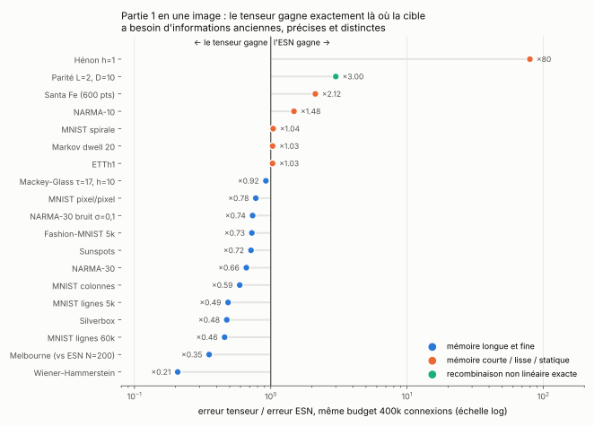
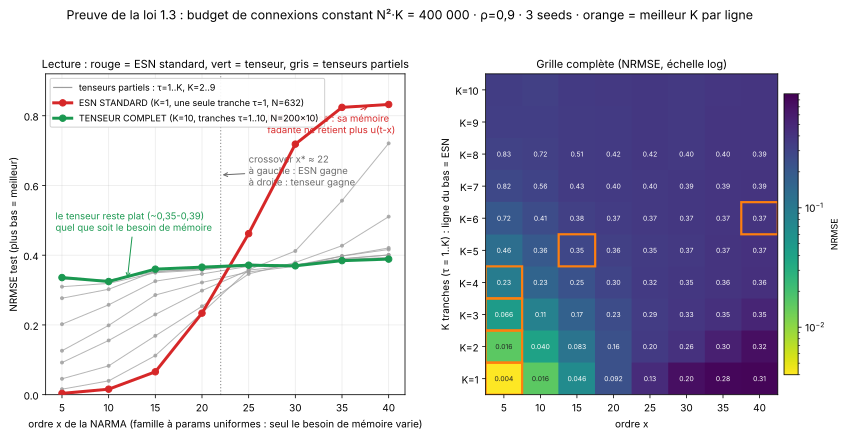
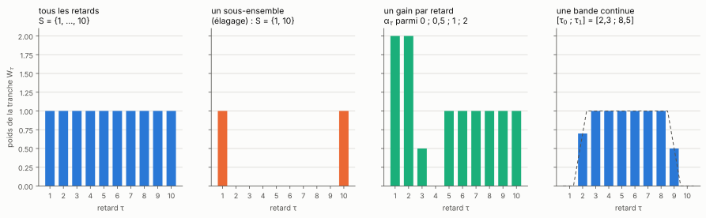
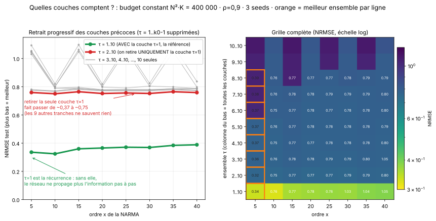
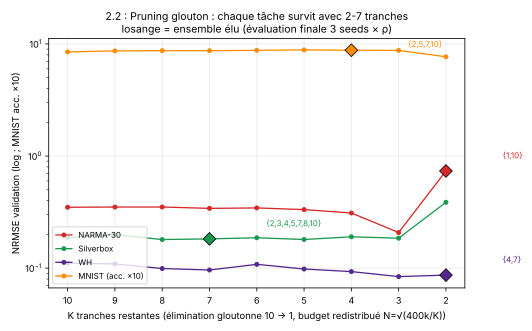

[Sommaire](../README.md#le-rapport) · [← Partie 0](0_modele.md) · [Partie 2 →](2_regle.md)

# Partie 1 — Où les retards gagnent, et quels retards garder

> **Ce qu'il faut retenir**
>
> - Contre un ESN sans fuite, S = {1, …, 10} gagne quand la tâche demande une information ancienne et précise : WH (erreur divisée par 4,8), Silverbox (par 2,1), MNIST lu ligne par ligne (+15 points), NARMA-30. Il perd quand l'information utile est récente : Hénon, NARMA-10, Santa Fe.
> - Sur NARMA-x, l'ESN gagne jusqu'à x ≈ 23, les retards au-delà.
> - Deux retards bien choisis battent dix retards uniformes : {1, 10} fait 0,051 sur NARMA-30, contre 0,388.
> - La référence ici est un ESN **sans fuite**. Avec une fuite, l'ESN rattrape une partie de l'écart (partie 4).

## 1.1 La campagne

ESN à 632 neurones contre S = {1, …, 10} à 200 neurones, tous les deux à 400 000 connexions, 3 seeds, ρ choisi sur la validation dans {0,5 ; 0,9 ; 0,99}.

| tâche | ESN, N = 632 | S = {1, …, 10}, N = 200 |
|---|---|---|
| Wiener-Hammerstein | 0,443 | **0,092** |
| Silverbox | 0,597 | **0,284** |
| MNIST lignes, 60 000 images (précision) | 72,3 % | **87,3 %** |
| NARMA-30 | 0,586 | **0,388** |
| capacité mémoire, k = 1 à 20 | 19,91 | **20,00** |
| Hénon, un pas | **0,0040** | 0,319 |
| parité L = 2, D = 10 | **0,204** | 0,612 |
| Santa Fe (600 points d'entraînement) | **0,047** | 0,053 |

Les cinq écarts principaux tiennent à 10 seeds (Wilcoxon apparié, p = 0,002) : WH 0,096 contre 0,435, Silverbox 0,362 contre 0,727, MNIST 87,1 % contre 72,6 %, NARMA-30 bruité (σ = 0,1) 0,660 contre 0,844, et {1, 10} en rang N/4 sur NARMA-30, 0,034 contre 0,559.

MNIST est lu avec une lecture sur l'état final seul, bien plus pauvre qu'une lecture sur tous les états : ces chiffres comparent deux réservoirs entre eux, pas à l'état de l'art.

Trois résultats aux frontières :

- **Bruit d'entrée** (NARMA-30, entrée u + σ·η) : les retards ne bougent pas à σ = 0,01 (0,391), l'ESN passe à 0,737.
- **Ordre de lecture de MNIST** : les retards font 81,7 %, 82,3 % et 82,3 % en lignes, colonnes et spirale ; l'ESN monte de 64,0 % à 83,2 % en spirale, où les pixels voisins restent voisins dans la séquence.
- **Parité** : l'ESN gagne (0,204 contre 0,612). Il manque le produit des deux bits ; un seul terme produit renverse le résultat (partie 3).

## 1.2 NARMA-x : l'ordre de la tâche contre le nombre de retards

Seul l'ordre x varie, de 5 à 40. En face, S = {1, …, K} pour K = 1 à 10, toujours à 400 000 connexions. ρ = 0,9, 3 seeds.

| x | ESN | S = {1, 2} | S = {1, …, 4} | S = {1, …, 10} |
|---|---|---|---|---|
| 5 | **0,004** | 0,016 | 0,092 | 0,336 |
| 20 | **0,234** | 0,235 | 0,298 | 0,366 |
| 30 | 0,718 | 0,412 | 0,371 | **0,370** |
| 40 | 0,832 | 0,721 | 0,421 | **0,389** |

- L'avantage de l'ESN fond quand x monte et s'inverse au croisement x\* = 23,0 [22,7 ; 23,2] (10 seeds).
- Les dix retards restent plats en x (0,33 à 0,39). L'ESN s'effondre.
- Sur les tâches courtes (x ≤ 10), chaque retard ajouté coûte : la partie 2 dit pourquoi (la mémoire se déplace vers les âges anciens).

## 1.3 Quels retards garder

Les bons retards sont cherchés de quatre façons, à budget constant, 3 seeds :

- **Retirer les retards courts** : S = {k₀, …, 10} pour k₀ croissant.
- **Élagage glouton** : à chaque étape, retirer le retard qui coûte le moins sur la validation, redistribuer le budget, retirer de zéro.
- **Un gain par retard** α_τ ∈ {0 ; 0,5 ; 1 ; 2}, appris par descente de coordonnées.
- **Une bande continue** [τ₀ ; τ₁], avec un poids fractionnaire aux bords.

Ce qui en sort :

- **NARMA** : le retard 1 est vital. Sans lui, l'erreur passe de 0,37 à 0,75 pour tout x. Sans le retard 1, elle reste vers 0,77 jusqu'à S = {15, …, 20}, puis saute à 1,035 dès {16, …, 20}.
- **Silverbox** : le retard 1 est inutile, l'enlever améliore ({2, …, 10} : 0,338 contre 0,357). Une large bande, de 2 à environ 17, est la meilleure.
- **WH** : les retards 1 à 3 sont inutiles, la bande utile va de 4 à 12 environ ({5, …, 10} : 0,081).
- **MNIST** : les retards courts sont inutiles ; {10, …, 20} fait 82,4 % sans aucun retard sous 10.
- **Un retard long seul ne marche nulle part.**
- **Les quatre méthodes tombent d'accord** sur chaque tâche : NARMA garde 1 et un retard long, Silverbox une large bande sans le 1, WH les retards 4 à 7, MNIST retire les courts.

L'élagage retient {1, 10} sur NARMA-30 (N = 447) : **0,051**, contre 0,388 pour les dix retards. Avec des tranches de rang N/4, {1, 10} descend à 0,035 avec la moitié des connexions. Sur WH, l'élagage retient {4, 7} (0,059).

## Bilan

**Où ça marche.** Sur les tâches qui demandent une information ancienne et distincte : systèmes physiques réels, images lues ligne par ligne, NARMA d'ordre élevé, entrées bruitées. Le choix de S compte plus que le nombre de retards.

**Les limites.** Les tâches à mémoire courte ou à recombinaison exactement non linéaire. Toutes ces méthodes cherchent S à l'aveugle, avec des dizaines de réservoirs entraînés, et la référence est un ESN sans fuite.

**Le lien avec la théorie.** La partie 2 explique ces signatures par une règle exacte (le retard 1 vital, la falaise à {16, …, 20}), et la partie 3 trouve un S encore meilleur sans aucune recherche, {1, 30}.

Scripts : `src/esn_tensor.py`, `src/suite_part1.py`, `src/suite_part1b.py`, `src/suite_real.py`, `src/mnist_esn.py`, `src/final60k.py`, `src/henon.py`, `src/suite_newtasks.py`, `src/narma_tau_sweep*.py`, `src/phys_tau_sweep.py`, `src/mnist_tau_sweep.py`, `src/prune_tau.py`, `src/eval_pruned.py`, `src/alpha_tau10.py`, `src/band_tau*.py`, `src/cp_rank.py`, `src/p7_4_stats.py`.

## Références

- Hénon, *A two-dimensional mapping with a strange attractor*, Communications in Mathematical Physics 50, 69–77 (1976).
- Weigend et Gershenfeld (éd.), *Time Series Prediction: Forecasting the Future and Understanding the Past*, Addison-Wesley (1994) : série A de Santa Fe.
- LeCun, Bottou, Bengio et Haffner, *Gradient-based learning applied to document recognition*, Proceedings of the IEEE 86 (1998) : MNIST.
- Liste complète : [references.md](references.md).

---

[Sommaire](../README.md#le-rapport) · [← Partie 0](0_modele.md) · [Partie 2 →](2_regle.md)
