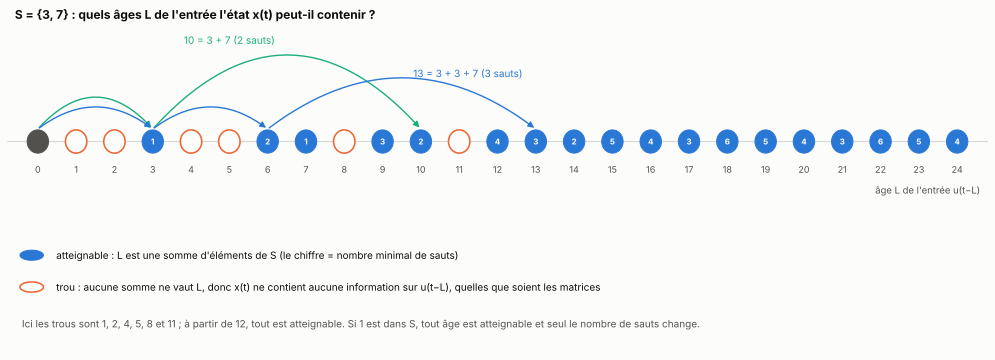
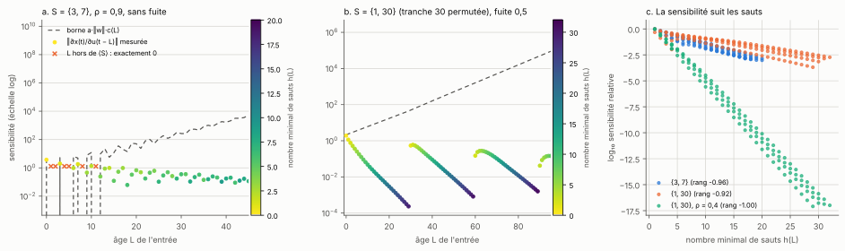
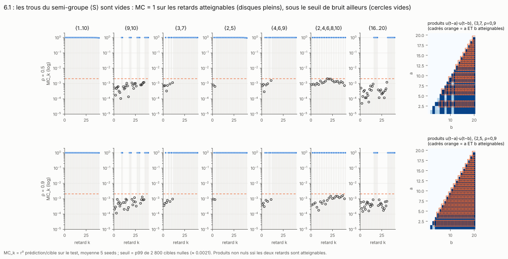
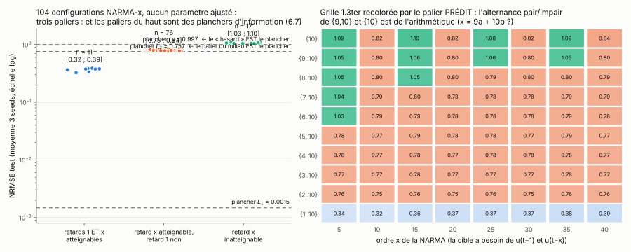
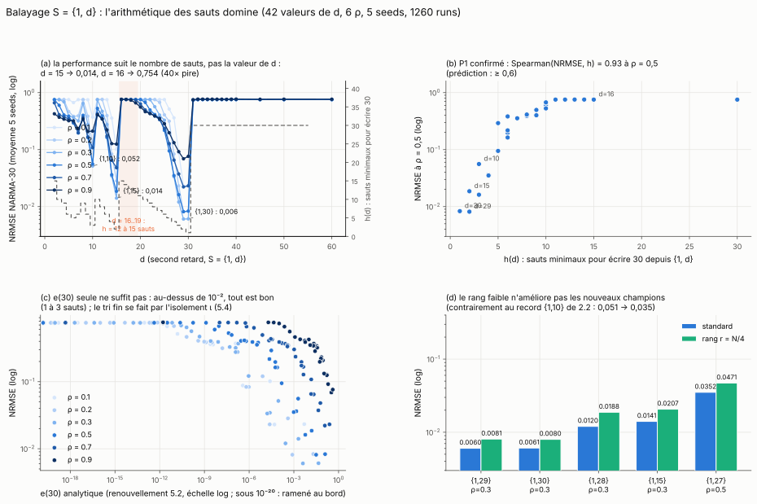
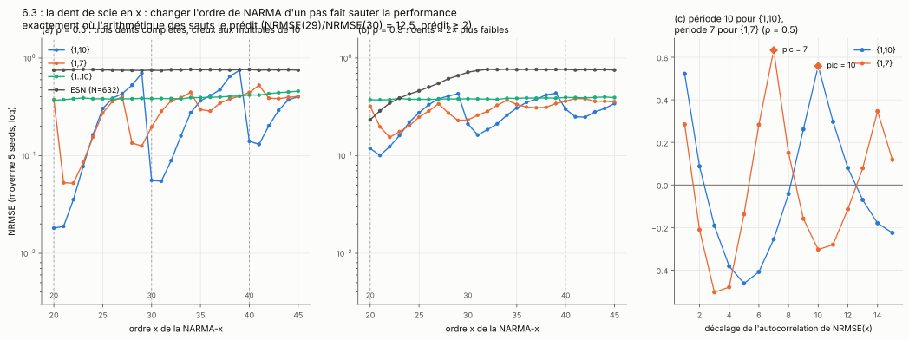
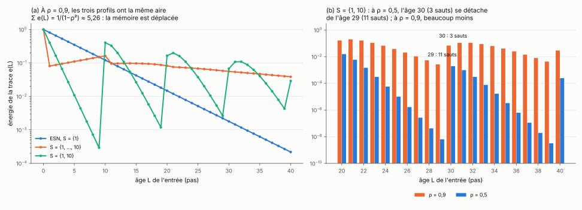

[Sommaire](../README.md#le-rapport) · [← Partie 1](1_ou_ca_gagne.md) · [Partie 3 →](3_calculer_S.md)

# Partie 2 — La règle des âges atteignables



> **Ce qu'il faut retenir**
>
> - x(t) ne peut dépendre de u(t−L) que si L est une somme d'éléments de S (répétitions permises). C'est exact, quelles que soient les matrices et la non-linéarité.
> - Réciproquement, pour presque tous les poids, x(t) dépend bien de chacun de ces âges. Et dans un réseau contractant, la sensibilité à l'âge L est bornée par s^{h_S(L)}, où h_S(L) est le nombre minimal de sauts : elle décroît avec le nombre de sauts, pas avec l'âge.
> - Ça range les 104 configurations NARMA déjà mesurées en trois paliers sans recouvrement, qui sont exactement les meilleures erreurs possibles avec l'information disponible : 0,0015, 0,757 et 0,997.
> - Ça prévoit des effets qu'on mesure : une falaise d'un facteur 40 entre {1, 15} et {1, 16} sur NARMA-30, une dent de scie quand l'ordre de NARMA varie.
> - Avec une entrée lisse, un âge manquant se devine à partir de ses voisins : la règle reste vraie, mais un trou coûte moins.
> - Côté quantité : les retards ne créent pas de mémoire, ils la déplacent (en champ moyen, l'énergie totale vaut 1/(1 − ρ²) quel que soit S).

## 2.1 La règle

On note ⟨S⟩ l'ensemble des entiers qui s'écrivent comme une somme d'éléments de S, plus 0. Par exemple ⟨{3, 7}⟩ = {0, 3, 6, 7, 9, 10, 12, 13, 14, …} : tous les entiers à partir de 12, et il manque 1, 2, 4, 5, 8 et 11.

**Règle.** x(t) est une fonction des seules entrées u(t − L) avec L ∈ ⟨S⟩.

**Preuve.** x(t) dépend de u(t) (L = 0) et des états x(t − τ) pour τ ∈ S. Par récurrence sur t, x(t − τ) ne dépend que des entrées u(t − τ − L') avec L' ∈ ⟨S⟩. Donc x(t) ne dépend que des u(t − L) avec L ∈ {0} ∪ (S + ⟨S⟩) = ⟨S⟩.

Rien n'est supposé sur les matrices, la non-linéarité ou la taille. Si l'entrée est tirée indépendamment à chaque pas, la conséquence est forte : **aucune lecture, linéaire ou non, ne peut retrouver u(t − k) dans x(t) si k ∉ ⟨S⟩**. L'information n'y est pas.

Trois remarques :

- **Si 1 ∈ S, tout âge est atteignable**, seul le nombre minimal de sauts change. C'est le cas de l'ESN.
- **Si le PGCD de S vaut d > 1**, seuls les multiples de d sont atteignables. {2, 4, 6, 8, 10} ne voit aucun âge impair.
- En maths, ⟨S⟩ est le **semi-groupe numérique** engendré par S. Quand le PGCD vaut 1, le plus grand entier manquant est le **nombre de Frobenius** : 11 pour {3, 7} (= 3·7 − 3 − 7).

On note aussi **h_S(L)** le nombre minimal de sauts pour écrire L avec des éléments de S (infini si L ∉ ⟨S⟩). Il se calcule comme un rendu de monnaie : h_S(0) = 0 et h_S(L) = 1 + min_{τ ∈ S, τ ≤ L} h_S(L − τ). Il sert à toute la suite.

Avec une fuite a < 1, l'état garde une part (1 − a)·x(t − 1) : le retard 1 s'ajoute à S. Avec un terme produit sur une paire de retards (p, q) (partie 3.5), p et q s'ajoutent aussi pour la règle. On note S' l'ensemble effectif.

## 2.2 La réciproque : presque tous les poids voient tous les âges atteignables

La règle est un « seulement si ». La réciproque dit que ce n'est pas un hasard des matrices si les âges atteignables sont lus.

**Théorème 1** (réseau sans terme produit). On note J_L(t) = ∂x(t)/∂u(t − L), calculé le long de la trajectoire d'entrée nulle. Pour presque tout tirage de W_in et des W_τ (au sens de la mesure de Lebesgue), J_L(t) ≠ 0 pour tout L ∈ ⟨S'⟩ avec L ≤ t.

**Preuve.** Les coefficients de J_L(t) sont des fonctions analytiques des poids, puisque tanh est analytique et que J_L(t) est une somme finie de produits de matrices et de dérivées de tanh. Une fonction analytique qui n'est pas identiquement nulle ne s'annule que sur un ensemble de mesure nulle. Il suffit donc d'un seul jeu de poids où J_L(t) ≠ 0 : W_τ = c·I avec c > 0, et les poids de la colonne constante de W_in nuls. L'état reste alors à zéro, tanh′ vaut 1, et J_L(t) est une somme de termes a^k·c^k·(1 − a)^j·w tous de même signe, sur toutes les façons d'écrire L avec des éléments de S'. Aucune compensation n'est possible, et il y a au moins un terme. L'union, dénombrable, des ensembles de mesure nulle sur L et t reste de mesure nulle. ∎

**Tranches structurées.** Avec des tranches permutées ou diagonales fixées (partie 4), le résultat reste vrai pour presque tout W_in : la matrice qui multiplie W_in est une somme de produits de matrices à coefficients positifs, non nulle, donc presque aucun W_in ne l'annule.

## 2.3 Une borne par le nombre de sauts

**Théorème 2.** On note α_τ = a·‖W_τ‖₂ (norme d'opérateur), plus (1 − a) pour τ = 1 (avec un terme produit sur (p, q), α_p et α_q gagnent chacun a·‖W₂‖₂, puisque |x| ≤ 1), et c(L) la suite définie par c(0) = 1 et c(L) = Σ_{τ ∈ S'} α_τ·c(L − τ). Pour le réseau non linéaire, sans approximation :

```
‖J_L(t)‖ ≤ a·‖w_u‖·c(L)          et, si s = Σ_τ α_τ < 1 :      c(L) ≤ s^{h_{S'}(L)}
```

où w_u est la colonne de W_in qui porte u.

**Preuve.** La dérivée de tanh est dans ]0 ; 1], donc chaque étape de la chaîne multiplie la norme par au plus α_τ, et J_L(t) = Σ_τ A_τ(t)·J_{L−τ}(t − τ) avec ‖A_τ(t)‖ ≤ α_τ. Par récurrence, ‖J_L‖ ≤ a·‖w_u‖·c(L). Pour la forme géométrique, h(L − τ) ≥ h(L) − 1, donc c(L) ≤ Σ_τ α_τ·s^{h(L)−1} = s^{h(L)} si s < 1. ∎

Dans un réseau contractant, la sensibilité à un âge décroît donc géométriquement avec le **nombre de sauts** pour l'atteindre, pas avec l'âge lui-même. Pour un ESN, h(L) = L et on retrouve la mémoire évanescente habituelle ; pour S = {1, 30}, l'âge 30 ne demande qu'un saut. C'est la justification du critère des sauts utilisé pour calculer S (partie 3).



**Vérification numérique** (26 réseaux : S = {3, 7}, {1, 30}, {1} et {4, 9} sur 20 tirages, tranches denses ou permutées, avec et sans fuite ; J_L calculée exactement par propagation de la tangente) :

- hors de ⟨S'⟩, J_L est exactement nulle ; dans ⟨S'⟩, elle n'est jamais nulle (la seule exception, l'ESN à ρ = 0,4 vers L = 120, vient du calcul en simple précision, qui descend sous le plus petit nombre représentable) ;
- la borne n'est jamais violée, mais elle est lâche : le rapport mesure / borne médian va de 10⁻²¹ à 10⁻⁴ ;
- la sensibilité suit les sauts : corrélation de rang entre log‖J_L‖ et h(L) de −0,92 à −1,00 ; sur {1, 30}, ‖J_30‖ est 2 300 fois plus grande que ‖J_29‖.

**La limite.** La condition s < 1 est rarement remplie par les réservoirs réglés : pour les recettes de la partie 4.3, s vaut 1,00 en médiane sur NARMA-30, 1,04 sur WH, 1,16 sur Silverbox et 2,24 sur la capacité mémoire (les normes d'opérateur d'une matrice gaussienne valent environ deux fois son rayon spectral). Au-dessus de 1, la forme géométrique ne dit rien ; la borne c(L) reste vraie mais ne fait que croître.

## 2.4 Les trous sont vides

Capacité MC_k (r² de la reconstruction de u(t − k)) pour k de 1 à 40, sept ensembles S, deux rayons, 5 seeds.



- Les âges atteignables sont reconstruits (MC jusqu'à 1,0000), de moins en moins quand le nombre de sauts augmente.
- Aucun trou ne dépasse 0,05. Les rares cases au-dessus du seuil de bruit (0,0021) ont r² ≤ 0,0039 et viennent des corrélations accidentelles de l'échantillon d'entrée : avec une autre réalisation, le même réservoir retombe à 0,0006.
- Sur les trajectoires (deux simulations identiques sauf une perturbation de 10⁻⁴ sur une entrée), la réponse aux âges manquants de {3, 7} est exactement nulle.

## 2.5 Les paliers de NARMA sont des planchers d'information

NARMA-x a besoin de u(t − 1) et de u(t − x). Chaque configuration déjà mesurée est classée selon que 1 et x sont dans ⟨S⟩ :



- 0,32 à 0,39 quand les deux âges sont atteignables ;
- 0,75 à 0,84 quand seul x l'est ;
- 1,03 à 1,10 quand x ne l'est pas.

Dans chaque palier, le nombre de retards ne change presque rien. Pour savoir si c'est une limite du réservoir ou de l'information, un ridge reçoit directement les entrées retardées u(t − L), L = 0 à 60, et tous leurs produits deux à deux (1 892 variables, 50 000 pas d'entraînement) :

| âges disponibles | meilleure erreur possible (NARMA-30) |
|---|---|
| tous | 0,0015 |
| tous sauf 1 | 0,757 |
| tous sauf 1 et 30 | 0,997 |

Les paliers du milieu et du haut sont donc exactement des planchers d'information. Au passage, NARMA-30 est presque une fonction de degré 2 des entrées passées.

## 2.6 Ce que la règle prévoit

**Un second retard qui varie.** S = {1, d} pour d de 2 à 60, N = 447, 5 seeds, ρ sur la validation.



- {1, 30} et {1, 29} font **0,006**, {1, 15} 0,014, {1, 10} 0,052. L'erreur suit le nombre de sauts pour écrire 30 (corrélation de rang 0,925).
- **Falaise** entre d = 15 et d = 16 : l'erreur est multipliée par 40 à ρ = 0,5 (0,019 contre 0,754). 30 = 15 + 15 tient en deux sauts ; avec 16 il en faut quinze (16 + 14 × 1).
- Pour d > 30, tout retombe à 0,753, le plancher « sans u(t − 30) ».

**L'ordre de la tâche qui varie.** S fixé, NARMA-x pour x de 20 à 45.



Avec {1, 10}, l'erreur est minimale aux multiples de 10 et maximale juste avant : 0,699 à x = 29, 0,056 à x = 30, une division par 12,5 pour un pas d'ordre. Avec {1, 7}, la période devient 7. Les dix retards {1, …, 10} restent plats, l'ESN n'a aucune périodicité.

**La tâche qui change.** Si le produit de NARMA-30 porte sur u(t)·u(t − 30), le retard 1 n'est plus vital. S'il porte sur u(t − 2)·u(t − 30), les ensembles qui n'atteignent pas l'âge 2 ({3, …, 10}, {3, 10}) tombent au plancher (0,748, 0,753) et {2, 10} fait 0,22.

**MNIST.** Avec une lecture sur l'état final x(27), la ligne j n'est visible que si 27 − j ∈ ⟨S⟩. Sous environ 14 lignes visibles, la précision chute ({20} : 2 lignes, 38,9 % ; {10} : 3 lignes, 65,1 %), au-dessus elle plafonne entre 81 et 85 %.

## 2.7 Entrées lisses : un trou coûte moins

La règle dit si un âge est atteignable, pas ce qu'un trou coûte. Si l'entrée est lisse, un âge manquant est corrélé à ses voisins. C'est mesuré sur des noyaux plantés, avec une entrée AR(1) u(t) = φ·u(t − 1) + √(1 − φ²)·ε(t) :

| noyau | cible | ce qu'il imite |
|---|---|---|
| pics | 1,5·u(t−1)·u(t−30) + 0,5·u(t−30) | NARMA-30 : deux âges nets et leur produit |
| bande | s + 0,3·s², s = Σ_L e^(−L/8)·cos(2πL/12)·u(t−L) | un système résonant amorti, comme Silverbox |
| îlots | s + 0,3·s², s = somme des u(t−L) pour L de 4 à 7 et de 15 à 20 | deux groupes d'âges, comme WH |

Plancher d'information d'un ensemble troué (ridge sur les seuls âges de ⟨S⟩ et leurs produits) selon le lissage φ :

| plancher | φ = 0 | 0,5 | 0,8 | 0,95 |
|---|---|---|---|---|
| pics, pairs {2, …, 10} | 0,978 | 0,761 | 0,498 | 0,243 |
| bande, pairs | 0,832 | 0,532 | 0,375 | 0,318 |
| îlots, pairs | 0,752 | 0,431 | 0,218 | 0,093 |

Sans trou, le plancher reste à 0,01. Avec un trou, c'est lui qui fixe l'erreur : le réservoir troué colle à son plancher, à 0,02 près sur la bande et les îlots. Plus l'entrée est lisse, moins le trou coûte. C'est pour ça que la règle seule ne suffit pas à choisir S sur Silverbox et WH, dont les entrées sont lisses.

## 2.8 Combien de mémoire : elle se déplace, elle ne se crée pas



La règle dit quels âges sont atteignables. Pour savoir avec quelle force, on linéarise le réseau et on suit une impulsion d'entrée : h(0) = W_in, puis h(L) = Σ_τ W_τ·h(L − τ). Pour des matrices gaussiennes indépendantes de rayon spectral ρ_τ, on a E‖W_τ v‖² ≈ ρ_τ²·‖v‖². En négligeant les termes croisés entre chemins différents, l'énergie e(L) = E‖h(L)‖² / ‖h(0)‖² vérifie :

```
e(0) = 1,      e(L) = Σ_{τ ∈ S, τ ≤ L} g_τ · e(L − τ),      g_τ = ρ_τ²
```

C'est l'équation de renouvellement : e(L) est le poids total de toutes les façons d'arriver exactement en L par des sauts pris dans S, chaque saut coûtant g_τ.

- **Conservation.** Si Σ_τ g_τ < 1, la somme des e(L) vaut 1 / (1 − Σ_τ g_τ). Avec ρ_τ = ρ/√K, Σ_τ g_τ = ρ² pour tout S : l'énergie totale vaut 1/(1 − ρ²) pour l'ESN, pour {1, …, 10} comme pour {1, 10}. (C'est une énergie de réponse linéaire, pas la capacité mémoire, qui reste bornée par N.)
- **Le prix des retards.** À ρ = 0,9, e(1) vaut 0,81 pour l'ESN et 0,081 pour dix retards uniformes. Ce que les tâches à mémoire longue gagnent, les tâches à mémoire courte le perdent (NARMA-10, Hénon, Santa Fe en partie 1).
- **Les limites.** Sur de vrais réseaux (perturbation de 10⁻⁴, N de 50 à 400), l'erreur médiane de la formule reste entre 31 et 49 % même corrigée du facteur moyen de la non-linéarité. Elle donne la forme des profils et les zéros exacts (pour {3, 7}, énergie mesurée nulle aux âges 1, 2, 4, 5, 8 et 11), pas les valeurs. Elle sert d'heuristique de forme, rien de plus.

## Bilan

**Où ça marche.** Pour une entrée indépendante d'un pas à l'autre, la règle dit à l'avance quels S sont condamnés, et les planchers disent à quel niveau. Les signatures de la partie 1 (retard 1 vital, falaise à {16, …, 20}, pairs contre impairs) en découlent toutes. La réciproque montre que les âges atteignables sont effectivement présents, et la borne relie leur force au nombre de sauts.

**Les limites.** La règle et sa réciproque sont élémentaires : un lecteur les trouvera évidentes. La borne n'est utile que pour un réseau contractant (s < 1), ce que les réservoirs réglés ne sont presque jamais, et elle est lâche de plusieurs ordres de grandeur. Pour les entrées lisses, la règle ne suffit plus à choisir S. Le champ moyen donne la forme des profils, pas leurs valeurs.

**Le lien avec la théorie.** En mathématiques, ⟨S⟩ est un semi-groupe numérique, et l'ensemble des longueurs de chemins dans un graphe à arêtes pondérées par des retards est un objet classique de la théorie des matrices primitives. Le nombre minimal de sauts correspond au « recurrent skip coefficient » de Zhang et al. (2016) et à la « mean recurrent length » des Dilated RNN (Chang et al., 2017), définis pour des RNN entraînés et motivés par le gradient, sans borne démontrée. L'idée de sauts pour atteindre un âge ancien est aussi observée par Iacob et Dambre (2024) dans des réservoirs à délais de propagation, et elle est derrière les RNN NARX et les MIST RNN. La condition Σ‖W_τ‖ < 1 est la condition suffisante usuelle de la propriété d'écho, étendue à plusieurs retards. L'équation de renouvellement est celle de Feller.

Scripts : `src/p6_common.py`, `src/p6_trous.py`, `src/p6_planchers.py`, `src/p6_balayage_d.py`, `src/p6_dents.py`, `src/p6_narma_modif.py`, `src/p6_champ_moyen.py`, `src/p11_trous_mous.py` (sous-commande `banc`), `src/theorie.py` (théorèmes 1 et 2), `src/plot_partie5_renouvellement.py`, `src/plot_p6_*.py`, `src/plot_figures.py`.

## Références

- Ramírez Alfonsín, *The Diophantine Frobenius Problem*, Oxford University Press (2005).
- Brualdi et Ryser, *Combinatorial Matrix Theory*, Cambridge University Press (1991), chapitre 3 (matrices primitives et exposants).
- Feller, *An Introduction to Probability Theory and Its Applications*, vol. 1, Wiley, chapitre XIII (équation de renouvellement).
- Zhang, Wu, Che, Lin, Memisevic, Salakhutdinov et Bengio, *Architectural Complexity Measures of Recurrent Neural Networks*, NeurIPS (2016), [arXiv:1602.08210](https://arxiv.org/abs/1602.08210).
- Chang et al., *Dilated Recurrent Neural Networks*, NeurIPS (2017), [arXiv:1710.02224](https://arxiv.org/abs/1710.02224).
- Lin, Horne, Tiňo et Giles, *Learning long-term dependencies in NARX recurrent neural networks*, IEEE Transactions on Neural Networks 7(6), 1329–1338 (1996).
- DiPietro, Rupprecht, Navab et Hager, *Analyzing and Exploiting NARX Recurrent Neural Networks for Long-Term Dependencies*, ICLR Workshop (2018), [arXiv:1702.07805](https://arxiv.org/abs/1702.07805).
- Iacob et Dambre, *Exploiting Signal Propagation Delays to Match Task Memory Requirements in Reservoir Computing*, Biomimetics 9(6), 355 (2024), [PMC](https://pmc.ncbi.nlm.nih.gov/articles/PMC11201534/).
- Jaeger, *The « echo state » approach to analysing and training recurrent neural networks*, GMD Report 148 (2001).
- Liste complète : [references.md](references.md).

---

[Sommaire](../README.md#le-rapport) · [← Partie 1](1_ou_ca_gagne.md) · [Partie 3 →](3_calculer_S.md)
