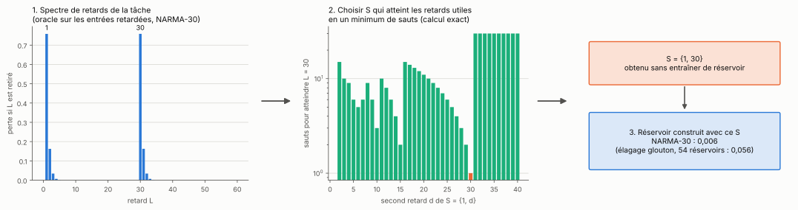
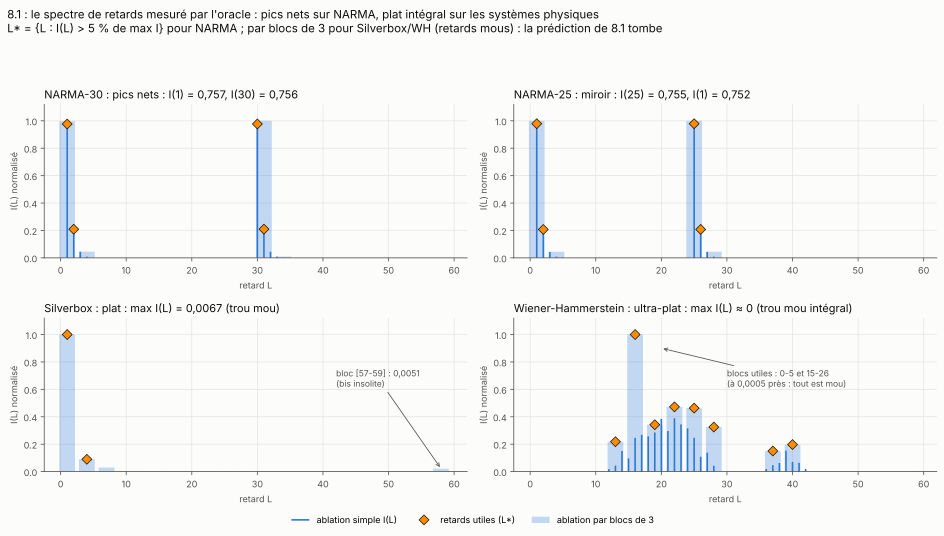
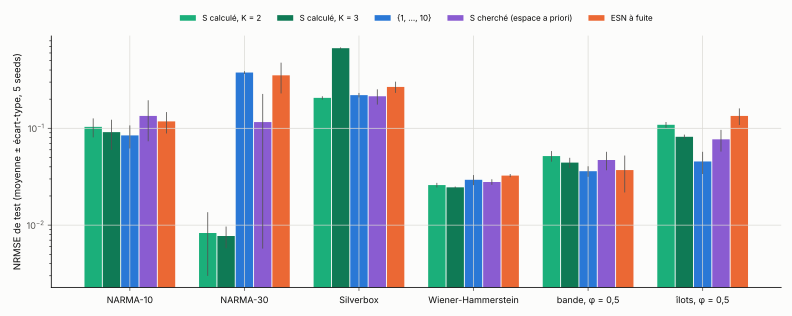
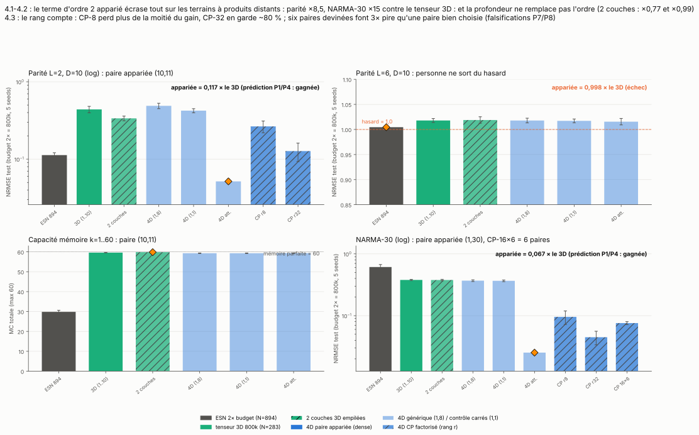
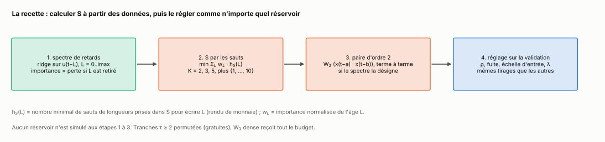

[Sommaire](../README.md#le-rapport) · [← Partie 2](2_regle.md) · [Partie 4 →](4_comparaisons.md)

# Partie 3 — Calculer S au lieu de le chercher



> **Ce qu'il faut retenir**
>
> - Le spectre de retards d'une tâche se mesure sans réservoir. Sur NARMA-30, il a des pics nets en 1, 2, 30 et 31.
> - Choisir le S qui atteint ces âges en un minimum de sauts donne {1, 30} : 0,006 sur NARMA-30, 9 fois mieux que l'élagage glouton, sans entraîner un seul réservoir pour le trouver.
> - À réglage égal (mêmes tirages de ρ, fuite et échelle d'entrée pour tout le monde), le S calculé est devant ou à égalité avec une recherche sur cinq tâches sur six, et devant l'ESN à fuite sur cinq sur six.
> - Ce qui le bat : {1, …, 10}, sur les tâches au spectre étalé. Ce n'est pas une question de nombre de retards, c'est la contiguïté.
> - Un terme produit sur la paire d'âges que désigne le spectre divise l'erreur par 15 sur NARMA-30 et par 8,5 sur la parité.
> - Tout ça forme la **recette** : spectre, S par les sauts, paire d'ordre 2, réglage comme les autres.

## 3.1 Le spectre de retards

Un ridge reçoit les entrées retardées u(t − L), L = 0 à lmax, et leurs produits deux à deux. L'importance I_L de l'âge L est la hausse de l'erreur de validation quand u(t − L) et tous les produits qui le contiennent sont retirés. Pour les entrées lisses, la même ablation se fait par blocs de trois âges. Tout se calcule en un passage sur les données (sous-matrices de la matrice de Gram), sans réservoir.



| tâche | erreur avec tous les âges | âges importants |
|---|---|---|
| NARMA-30 | 0,0015 | 1 et 30 (0,757 chacun), 2 et 31 (0,16), 32 (0,03) |
| NARMA-25 | 0,0013 | 1 et 25, puis 2 et 26 |
| Silverbox | 0,219 | aucun âge seul au-dessus de 4·10⁻⁵ : spectre plat |
| Wiener-Hammerstein | 0,088 | aucun âge seul au-dessus de 6·10⁻⁶ : spectre plat |

## 3.2 Le calcul de S

Avec w_L = I_L / Σ I (le spectre normalisé), on cherche le S de K retards, contenant 1, qui minimise

```
coût(S) = Σ_L w_L · h_S(L)
```

où h_S(L) est le nombre minimal de sauts de la partie 2. Le théorème 2 de la partie 2.3 justifie ce choix : dans un réseau contractant, la sensibilité à l'âge L est bornée par s^{h_S(L)}. Recherche exhaustive pour K ≤ 3, gloutonne au-delà. Aucun réservoir n'est simulé.

| tâche | K = 2 | K = 3 | K = 4 |
|---|---|---|---|
| NARMA-30 | {1, 30} | {1, 30, 31} | {1, 2, 30, 31} |
| NARMA-25 | {1, 25} | {1, 25, 26} | {1, 2, 25, 26} |

À 400 000 connexions, 5 seeds, ρ choisi sur la validation :

| configuration | NARMA-30 | NARMA-25 | réservoirs à entraîner pour trouver S |
|---|---|---|---|
| **S calculé, K = 2** | **0,0061** | **0,0055** | 0 |
| élagage glouton | 0,056 ({1, 10}) | 0,266 ({1, 4}) | 54 |
| bande continue | 0,383 | 0,380 | 37 à 65 |
| {1, …, 10} | 0,382 | 0,378 | 0 |
| ESN | 0,716 | 0,461 | 0 |

Le calcul bat l'élagage de 9 fois sur NARMA-30 et 48 fois sur NARMA-25.

## 3.3 À réglage égal

Le tableau précédent ne règle que ρ. Pour une comparaison juste, chaque famille reçoit les mêmes 30 tirages de ρ (uniforme sur [0,3 ; 1,1]), de fuite (uniforme sur [0,05 ; 1]) et d'échelle d'entrée (log-uniforme sur [0,05 ; 2]), choix sur la validation, 5 seeds. Tranches de retard permutées (partie 4). La famille « cherché » tire en plus son S parmi 19 ensembles fixés a priori (uniformes, puissances de 2, pairs, bandes, {1, d}). Le S calculé est fixé avant toute simulation, sur l'entraînement.



| tâche | S calculé, K = 2 | S calculé, K = 3 | {1, …, 10} | cherché | ESN à fuite |
|---|---|---|---|---|---|
| NARMA-10 | 0,104 | 0,091 | **0,085** | 0,134 | 0,118 |
| NARMA-30 | 0,0083 | **0,0077** | 0,377 | 0,116 | 0,353 |
| Silverbox | **0,206** | 0,672 | 0,220 | 0,214 | 0,268 |
| Wiener-Hammerstein | 0,0259 | **0,0246** | 0,0294 | 0,0279 | 0,0325 |
| bande, φ = 0,5 | 0,052 | 0,044 | **0,036** | 0,047 | 0,037 |
| îlots, φ = 0,5 | 0,109 | 0,082 | **0,046** | 0,077 | 0,134 |

- **Sur Silverbox et WH, le S calculé ne perd plus.** Avec seulement ρ à régler, il y perdait contre la recherche à l'aveugle. Avec la fuite et l'échelle d'entrée, {1, 6, 10} est le meilleur sur WH (5 seeds sur 5 contre la recherche), et {1, 12} est à égalité avec la recherche sur Silverbox.
- **Il bat l'ESN à fuite sur cinq tâches sur six** (toutes sauf la bande).
- **{1, …, 10} le bat sur les trois spectres étalés** : NARMA-10, bande, îlots (de 8,6 à 11,1 âges effectifs).
- **K = 3 peut s'effondrer** : sur Silverbox, le troisième retard part sur un bloc d'âges lointains, {1, 31, 37}, et fait 0,672.

## 3.4 Peu de retards ou les bons retards ?

Avec des tranches permutées, un retard ne coûte rien : {1, …, 10} a cinq fois plus de retards que le S calculé à K = 2. Est-ce que c'est juste le nombre qui compte ? Même réglage, trois familles de plus :

| tâche | S calculé, K = 5 | S calculé, K = 10 | 10 retards au hasard | {1, …, 10} |
|---|---|---|---|---|
| NARMA-10 | 0,096 | 0,120 | 0,336 | **0,085** |
| NARMA-30 | 0,019 | 0,067 | 0,341 | 0,377 |
| bande, φ = 0,5 | 0,039 | 0,045 | 0,332 | **0,036** |
| îlots, φ = 0,5 | 0,054 | 0,062 | 0,282 | **0,046** |

- **Le nombre seul n'explique rien** : dix retards au hasard font 4 à 9 fois pire que {1, …, 10}.
- **Ajouter des retards calculés aide jusqu'à K = 5** (îlots : 0,109 → 0,082 → 0,054), puis coûte. Sur NARMA-30, chaque retard ajouté à {1, 2, 30} dégrade (0,0077, 0,019, 0,067) : chaque tranche a le rayon ρ/√K, donc chaque retard en plus retire de l'énergie aux chemins utiles (partie 2.8).
- **Ce qui distingue {1, …, 10}, c'est la contiguïté** : tout âge jusqu'à 10 s'atteint en un saut, et chaque âge plus ancien par de nombreux chemins. Le critère des sauts ne compte que le chemin le plus court. Un critère qui compte tous les chemins (l'énergie de renouvellement e_S(L) de la partie 2.8, au lieu de h_S(L)) est la piste évidente. Elle a été formulée en voyant ces tâches, donc elle reste à tester sur d'autres.

Deux boutons ont aussi été tournés pour tenter de faire perdre le S calculé sur une tâche plantée, le lissage de l'entrée (qui rend chaque âge moins visible) et une rétroaction de sortie (qui donne à la cible un passé infini). Aucun ne le fait perdre contre l'ESN à fuite : il reste devant sur 5 seeds sur 5 à toutes les valeurs. L'écart se réduit seulement quand l'entrée devient très lisse (les autres devinent les âges manquants) ou quand toutes les familles s'approchent de 1.

## 3.5 Un terme produit entre deux états passés

NARMA-30 contient 1,5·u(t − 1)·u(t − 30), et XOR(a, b) = a + b − 2ab. Une lecture linéaire sait faire a + b, pas ab. D'où un seul terme de plus :

```
x(t) = tanh( W_in·u(t) + Σ_{τ ∈ S} W_τ·x(t−τ) + W₂·( x(t−a) ⊙ x(t−b) ) )
```

où ⊙ est le produit terme à terme et W₂ une matrice N×N tirée comme les autres (elle compte dans le budget). S = {1, …, 10}, 800 000 connexions pour tout le monde, 5 seeds.



| configuration | parité 2 bits | NARMA-30 |
|---|---|---|
| ESN | 0,113 | 0,612 |
| {1, …, 10} | 0,439 | 0,379 |
| deux réservoirs empilés | 0,337 | 0,377 |
| + paire quelconque (1, 8) | 0,489 | 0,369 |
| + carrés (1, 1) | 0,423 | 0,366 |
| **+ paire de la tâche** : (10, 11) pour la parité, (1, 30) pour NARMA | **0,052** | **0,025** |

La bonne paire divise l'erreur par 8,5 sur la parité (et bat l'ESN, qui gagnait cette tâche) et par 15 sur NARMA-30. Une paire quelconque, les carrés ou une seconde couche n'apportent rien. Le terme veut un rang élevé : en rang 32, il garde 80 % du gain sur la parité, en rang 8, 45 %. Et il ne va pas au-delà du degré 2 : sur la parité de six bits, tout le monde reste au hasard.

La paire n'a pas à être devinée : le spectre de 3.1 mesure aussi l'importance de chaque produit u(t − a)·u(t − b).

## 3.6 La recette



1. **Spectre** de la tâche sur l'entraînement (âges 0 à 40, produits compris).
2. **Quatre candidats S** : les sauts pour K = 2, 3 et 5, plus {1, …, 10} pour les spectres étalés.
3. **Paire d'ordre 2** : le produit u(t − a)·u(t − b), a ≠ b, le plus important du spectre, ajouté s'il porte au moins 10 % de l'importance totale.
4. **Réglage** : les mêmes tirages de ρ, fuite et échelle d'entrée pour chaque candidat, 60 évaluations en tout, choix sur la validation. Tranches τ ≥ 2 permutées, W₁ dense.

Ce que la recette retient, à 10 seeds (résultats complets en partie 4) :

| tâche | configuration retenue | erreur |
|---|---|---|
| NARMA-30 | {1, 2, 30} et paire (1, 30) (9 seeds sur 10) | **0,0042** |
| Silverbox | {1, 12} (10 seeds sur 10) | 0,200 |
| Wiener-Hammerstein | {1, …, 10} (7 seeds), {1, 6, 10} (3 seeds) | 0,0425 |
| MNIST lignes | variable selon la seed | 8,5 % d'erreur |
| capacité mémoire | {1, 8, 13} (8 seeds) | 223 sur 300 |

## Bilan

**Où ça marche.** Quand le spectre a des pics, la règle des sauts donne le réservoir directement, sans recherche, et c'est le meilleur réservoir de l'étude sur NARMA-30 (0,0042). À réglage égal, le S calculé tient aussi sur les spectres plats de Silverbox et WH.

**Les limites.** Sur les spectres étalés, {1, …, 10} fait mieux, de 1,2 à 2,4 fois : le critère des sauts ignore le nombre de chemins. Sur NARMA-30, un ESN qui reçoit directement u(t − 30) en entrée fait encore mieux (partie 4) : ce qui compte, c'est l'accès aux bons âges, par l'état ou par l'entrée. Et la partie 4.7 montre que le même S, placé dans la lecture plutôt que dans l'état, gagne sur WH et MNIST.

**Le lien avec la théorie.** Le spectre est une ablation de variables d'un modèle linéaire en les âges et leurs produits, proche du NG-RC (Gauthier et al., 2021) et des capacités de traitement de l'information (Dambre et al., 2012). Le calcul de S est un problème de rendu de monnaie pondéré, résolu exactement pour K ≤ 3. Le terme produit est un terme de degré 2 de la décomposition de Dambre et al., restreint à une seule paire.

Scripts : `src/p8_spectre.py`, `src/p8_calcul.py`, `src/p8_conception.py`, `src/controle_conception.py` (sous-commandes `reglage`, `boutons`, `nombre`), `src/p4_tenseur.py`, `src/p4_cp.py`, `src/p12_synthese.py recette`, `src/conception.py`.

## Références

- Gauthier, Bollt, Griffith et Barbosa, *Next generation reservoir computing*, Nature Communications 12, 5564 (2021).
- Dambre, Verstraeten, Schrauwen et Massar, *Information processing capacity of dynamical systems*, Scientific Reports 2 (2012).
- Liste complète : [references.md](references.md).

---

[Sommaire](../README.md#le-rapport) · [← Partie 2](2_regle.md) · [Partie 4 →](4_comparaisons.md)
