[Sommaire](../README.md#le-rapport) · [← Partie 3](3_calculer_S.md) · [Partie 5 →](5_series_reelles.md)

# Partie 4 — Contre les références, à réglage égal

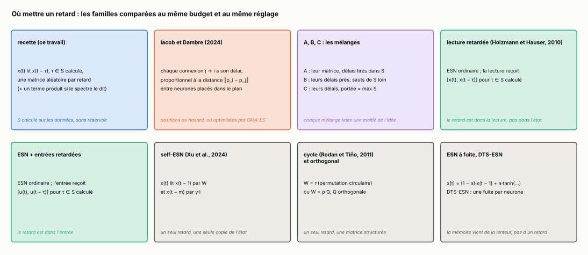

> **Ce qu'il faut retenir**
>
> - Une tranche de retard n'a pas besoin d'être une matrice dense : une permutation aléatoire fait aussi bien sans rien coûter. Une tranche identité, en revanche, effondre la mémoire.
> - Avec le même réglage pour tout le monde (60 évaluations, fuite permise partout, 10 seeds), le réservoir à retards avec fuite bat l'ESN à fuite sur les cinq tâches de développement. Les écarts sont grands sur NARMA-30, Silverbox et la capacité mémoire, petits sur WH et MNIST (−9 % et −10 %).
> - La recette fait 0,0042 sur NARMA-30 et dès 25 000 connexions reste 62 fois meilleure que l'ESN à fuite à 1 600 000.
> - Mais sur NARMA-30, un ESN qui reçoit directement les âges du S calculé en entrée fait encore mieux (0,0010), et le NG-RC fait aussi bien que la recette. Le réservoir à retards garde son intérêt propre là où les entrées retardées n'aident pas : Silverbox, WH, capacité mémoire.
> - Contre le modèle d'Iacob et Dambre (2024), des délais de propagation tirés de la géométrie : la recette gagne d'un facteur 80 sur NARMA-30, perd sur Silverbox, WH et la capacité mémoire, et fait jeu égal sur MNIST. Avec leurs positions optimisées par CMA-ES, leur modèle devient le meilleur sur Silverbox (0,175) et atteint 299,9 sur 300 en capacité mémoire, mais reste 54 fois derrière la recette sur NARMA-30. Les trois mélanges ne font pas mieux que le meilleur de leurs deux parents.
> - Le même S calculé, placé dans la lecture ([x(t), x(t − τ)]) au lieu de l'état, est meilleur que la recette sur WH (0,0217 contre 0,0425) et MNIST (7,2 % contre 8,5 % d'erreur), avec une lecture plus grande. Self-ESN, réservoir en cycle et réservoir orthogonal restent à moins de 17 % de l'ESN à fuite sur les tâches de développement et perdent sur les noyaux plantés.

## 4.1 Les tranches gratuites

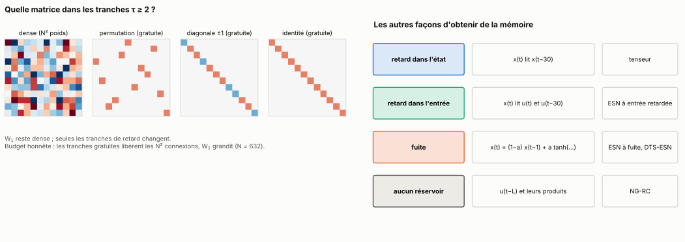

Tout le calcul « budget égal » suppose qu'une tranche coûte N². W₁ reste dense, et les tranches τ ≥ 2 sont remplacées par une permutation aléatoire, une diagonale de ±1 aléatoires ou l'identité, toutes au rayon ρ/√K. Comme elles ne coûtent rien, W₁ récupère tout le budget (N = 632). 5 seeds.

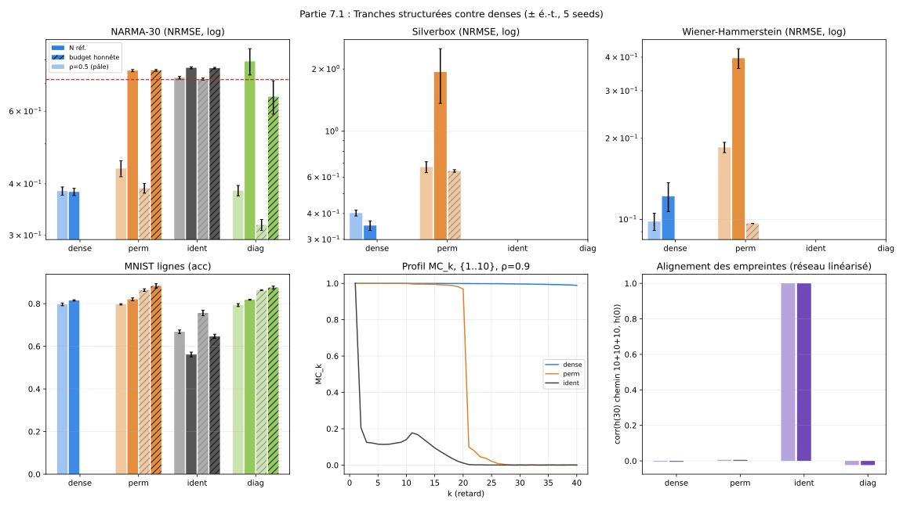

| tâche | dense | permutation | diagonale ±1 | identité | ESN |
|---|---|---|---|---|---|
| NARMA-30, {1, 10} | 0,056 | **0,033** | 0,317 | 0,486 | 0,716 |
| Silverbox, {1, …, 10} | 0,350 | 0,664 | **0,211** | 1,454 | 0,725 |
| WH, {1, …, 10} | 0,098 | 0,096 | **0,085** | 0,296 | 0,439 |
| MNIST, {1, …, 10} (précision) | 81,6 % | **88,3 %** | 87,6 % | 75,7 % | 62,3 % |
| capacité mémoire (k ≤ 40), {1, …, 10} | 39,9 | 39,8 | **40,0** | 9,5 | 27,8 |

- **L'identité effondre la mémoire** (9,5 sur 40 contre 39,9). Avec l'identité, une entrée qui fait trois sauts de 10 garde exactement la direction de sa trace de départ (corrélation 1 dans le réseau linéarisé, contre environ 0 pour les autres tranches) : les traces de différents âges s'alignent et se recouvrent. Avec une permutation ou une matrice aléatoire, des chemins différents laissent des traces différentes.
- **Permutations et diagonales suffisent**, et le budget libéré pour W₁ améliore souvent le résultat. Ce qui compte n'est pas le nombre de poids des tranches mais qu'elles mélangent les neurones.

C'est aussi le mécanisme des réservoirs physiques à retard quand le retard égale l'horloge (partie 6).

## 4.2 Le retard dans l'entrée, et le NG-RC

**Entrées retardées.** Un ESN de 632 neurones reçoit [u(t), u(t − d₁), …, u(t − d_m), 1] au lieu de [u(t), 1].

- NARMA-30 : avec u(t − 30) en entrée, il fait **0,0047**, mieux que {1, 30} (0,006). Il faut un accès à u(t − 30), et une entrée retardée le donne sans aucun saut.
- Silverbox et WH : le meilleur ESN à entrées retardées fait 0,626 et 0,266, contre 0,350 et 0,098 pour {1, …, 10}. Sur ces systèmes physiques, ce qui compte est l'état filtré par le réservoir, pas l'accès à des entrées anciennes.

**NG-RC** (Gauthier et al., 2021) : pas de réservoir, juste les entrées retardées et leurs produits, lus par ridge. Avec les retards 1 à 30 et leurs produits, il fait 0,178 sur NARMA-30, mieux que {1, …, 10} mais loin de {1, 30} (0,006). Sur Silverbox et WH, il est derrière le réservoir à retards (0,412 et 0,117).

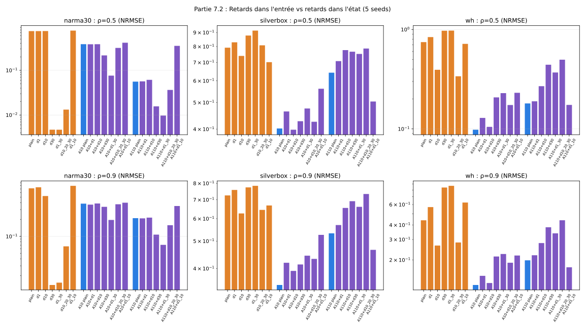

## 4.3 Réglage équitable, fuite permise partout

C'est la comparaison principale. Six familles, 60 évaluations de recherche aléatoire chacune sur la validation, puis test de la meilleure. 400 000 connexions, 10 seeds.

| famille | ce qui est tiré |
|---|---|
| ESN à fuite | ρ ∈ [0,3 ; 1,1], fuite ∈ [0,05 ; 1], échelle d'entrée log-uniforme sur [0,05 ; 2] |
| ESN + entrées retardées | le même ESN à fuite, qui reçoit en plus u(t − τ) pour τ dans le S calculé (K = 2) et le produit de la paire du spectre |
| DTS-ESN (Tanaka et al., 2022) | ρ, échelle d'entrée, une fuite par neurone tirée log-uniformément sur [a_min ; 1], a_min ∈ [0,01 ; 0,3] |
| retards avec fuite | S parmi 19 ensembles fixés a priori (aucun ensemble trouvé sur ces tâches dans les parties 1 et 3), tranches denses, permutées ou diagonales, ρ, fuite, échelle |
| retards sans fuite | pareil, fuite = 1 |
| recette | partie 3.6 |

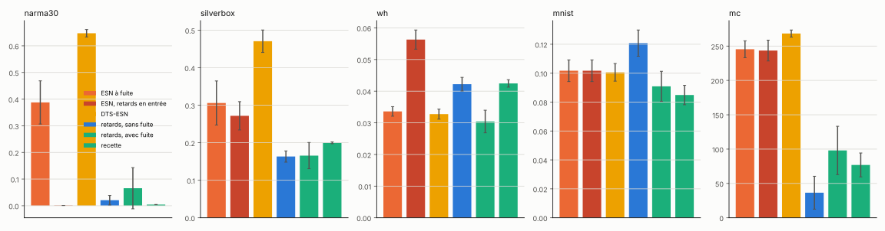

| tâche | ESN à fuite | ESN + entrées retardées | DTS-ESN | retards sans fuite | retards avec fuite | recette |
|---|---|---|---|---|---|---|
| NARMA-30 | 0,388 | **0,0010** | 0,647 | 0,021 | 0,066 | 0,0042 |
| Silverbox | 0,306 | 0,272 | 0,471 | **0,163** | 0,166 | 0,200 |
| Wiener-Hammerstein | 0,0336 | 0,0563 | 0,0327 | 0,0422 | **0,0304** | 0,0425 |
| MNIST lignes, erreur | 10,2 % | (= ESN à fuite) | 10,1 % | 12,1 % | 9,1 % | **8,5 %** |
| capacité mémoire (sur 300) | 54,6 | 56,5 | 31,7 | **263,5** | 202,0 | 223,1 |

Rapport apparié à l'ESN à fuite, Wilcoxon apparié corrigé par Holm sur les cinq comparaisons de chaque tâche :

| tâche | retards avec fuite | retards sans fuite | recette | ESN + entrées retardées | DTS-ESN |
|---|---|---|---|---|---|
| NARMA-30 | ×0,17, p = 0,01 | ×0,055, p = 0,01 | ×0,011, p = 0,01 | ×0,003, p = 0,01 | ×1,75, p = 0,01 |
| Silverbox | ×0,56, p = 0,01 | ×0,55, p = 0,01 | ×0,68, p = 0,01 | ×0,90, p = 0,04 | ×1,59, p = 0,01 |
| Wiener-Hammerstein | ×0,91, p = 0,04 | ×1,26, p = 0,01 | ×1,27, p = 0,01 | ×1,68, p = 0,01 | ×0,98, p = 0,43 |
| MNIST lignes, erreur | ×0,90, p = 0,035 | ×1,20, p = 0,02 | ×0,84, p = 0,02 | identique | ×1,00, p = 1 |
| capacité mémoire, 300 − MC | ×0,40, p = 0,01 | ×0,15, p = 0,01 | ×0,31, p = 0,01 | ×0,99, p = 0,85 | ×1,09, p = 0,01 |

- **Retards avec fuite contre ESN à fuite** : devant sur les cinq tâches, significatif sur les cinq.
- **La fuite et les retards font deux choses différentes.** La fuite règle la vitesse d'oubli, les retards choisissent quels âges l'état peut contenir. La fuite fait passer les retards devant sur WH et MNIST (fuites retenues de 0,27 et 0,4). Sur NARMA-30 et la capacité mémoire, où les âges utiles sont anciens, elle les efface et la version sans fuite est meilleure.
- **La recette** est le meilleur réservoir sur NARMA-30 (0,0042) et la meilleure famille sur MNIST. Elle perd sur WH (0,0425 contre 0,0336) : les tranches permutées et le petit nombre de S proposés y coûtent plus que le calcul n'apporte.
- **Pourquoi un réservoir ?** Sur NARMA-30, l'ESN qui reçoit les âges du S calculé en entrée fait 0,0010 : quand le noyau d'une tâche tient en quelques âges nets connus d'avance, les donner en entrée suffit. Le réservoir à retards garde un intérêt là où ça n'aide pas (Silverbox 0,166 contre 0,272, WH 0,0304 contre 0,0563, capacité 202 contre 56), et quand on ne peut changer que des boucles, pas l'entrée (réservoir physique, partie 6).

MNIST : 5 000 images d'entraînement, lecture sur l'état final seul, donc pas comparable aux ESN publiés (un ESN de 1 000 neurones lu sur tous ses états, entraîné sur 60 000 images, fait 4,8 % d'erreur, Manneschi et al., 2023).

## 4.4 Selon le budget

Budgets de 25 000 à 1 600 000 connexions (ESN de 158 à 1 265 neurones). Réglage sur des seeds jamais testées (pour Silverbox, WH et MNIST, sur la validation de l'unique réalisation), test sur 10 seeds. ESN à fuite, DTS-ESN, retards avec fuite et recette : 30 évaluations chacun. Dix retards uniformes et NG-RC : presque sans réglage.

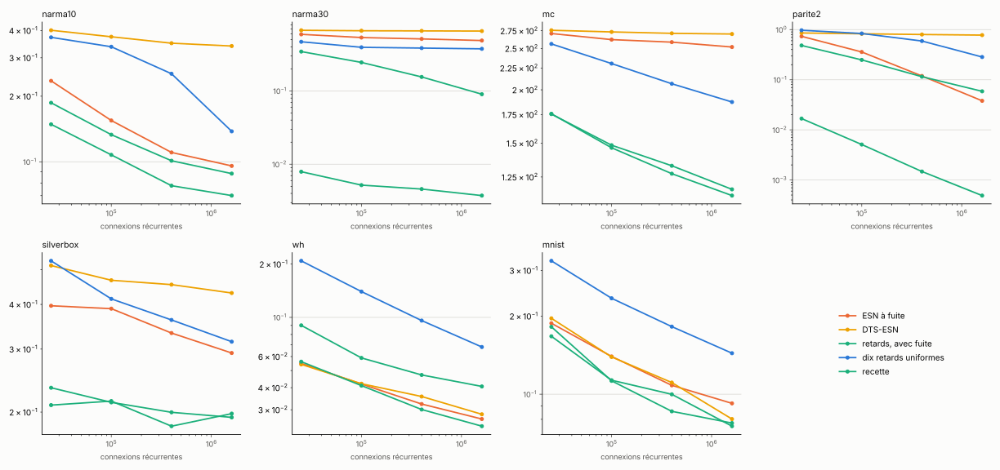

De 25 000 à 1 600 000 connexions :

| tâche | ESN à fuite | DTS-ESN | retards avec fuite | recette | NG-RC |
|---|---|---|---|---|---|
| NARMA-10 | 0,235 → 0,096 | 0,401 → 0,340 | 0,187 → 0,088 | 0,149 → **0,070** | 0,074 |
| NARMA-30 | 0,591 → 0,487 | 0,672 → 0,655 | 0,344 → 0,090 | 0,0079 → **0,0037** | 0,0039 |
| capacité mémoire (sur 300) | 29 → 48 | 24 → 30 | 125 → 183 | 124 → **187** | |
| parité | 0,73 → 0,038 | 0,86 → 0,78 | 0,48 → 0,059 | 0,017 → 0,0005 | **≈ 0** |
| Silverbox | 0,397 → 0,293 | 0,514 → 0,431 | **0,209** → 0,198 | 0,234 → **0,193** | 0,301 |
| Wiener-Hammerstein | 0,0549 → 0,0266 | 0,0542 → 0,0283 | 0,0561 → **0,0242** | 0,090 → 0,041 | 0,092 |
| MNIST lignes, erreur | 18,8 % → 9,2 % | 19,6 % → 8,0 % | **16,7 % → 7,5 %** | 18,2 % → 7,7 % | |

- **NARMA-30** : la recette à 25 000 connexions (0,0079) fait 62 fois mieux que l'ESN à fuite à 1 600 000 (0,487). Le NG-RC, sans connexion récurrente, fait 0,0039 : à égalité.
- **Parité** : le NG-RC est exact. La recette atteint 0,0005.
- **Silverbox, MNIST** : une famille à retards est devant à tous les budgets. **WH** : à partir de 400 000 connexions.

## 4.5 Selon la longueur d'entraînement

Les modèles réglés en 4.3, lecture réapprise sur un tronçon de longueur L, test fixe, 10 seeds.

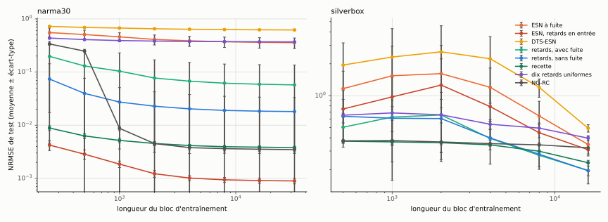

| | NARMA-30, L = 250 | NARMA-30, L = 32 000 | Silverbox, L = 500 | Silverbox, L = 16 000 |
|---|---|---|---|---|
| ESN à fuite | 0,552 | 0,357 | 1,17 | 0,345 |
| ESN + entrées retardées | **0,0042** | **0,0009** | 0,749 | 0,308 |
| retards, avec fuite | 0,198 | 0,057 | 0,504 | **0,196** |
| recette | 0,0089 | 0,0038 | **0,372** | 0,233 |
| NG-RC | 0,338 | 0,0035 | 0,374 | 0,322 |

Avec 250 pas, la recette est déjà sous 0,01 sur NARMA-30. Le NG-RC a besoin d'au moins 1 000 pas : ses 861 paramètres de lecture demandent des données.

## 4.6 Contre Iacob et Dambre (2024), et trois mélanges

C'est le travail publié le plus proche : un ESN à fuite où chaque connexion j → i a un délai de propagation proportionnel à la distance entre les deux neurones placés dans le plan. Chaque délai entier a ainsi sa propre matrice creuse, comme une tranche W_τ, mais les délais viennent de la géométrie, pas d'un calcul sur la tâche. Sur ces tâches déjà ouvertes, la comparaison est **exploratoire** ; la comparaison pré-enregistrée est en partie 5.6.

**Le modèle.** N = 632, une matrice dense W de rayon ρ, positions p_i tirées uniformément dans [0 ; 1]², délai D_ij = 1 + round((dmax − 1)·‖p_i − p_j‖ / √2), et

```
x(t) = (1 − a)·x(t − 1) + a·tanh( W_in·u(t) + Σ_j W_ij·x_j(t − D_ij) )
```

Iacob et Dambre optimisent ensuite les positions par CMA-ES. Deux versions sont comparées : positions aléatoires (leur point de départ), avec dmax réglé comme ρ, la fuite et l'échelle d'entrée ; et positions optimisées (fin de la section).

**Trois mélanges** avec la recette, au même budget de 400 000 connexions :

| famille | délais | ce que ça teste |
|---|---|---|
| Iacob-Dambre | propagation, 1 à dmax, dmax ∈ [2 ; 40] réglé | leur modèle |
| A | même matrice, délai de chaque connexion tiré uniformément dans le S calculé | leur architecture avec les retards de la recette |
| B | propagation 1 à dmax pour la mémoire proche, plus une tranche permutée gratuite pour chaque retard de S plus long que dmax, plus la paire d'ordre 2 si la recette en a une (N = 447 dans ce cas) | contigu près, sauts calculés loin |
| C | propagation, dmax = max S au lieu d'être réglé | la portée calculée, sans le placement |

Même protocole qu'en 4.3 : mêmes tirages de ρ, fuite et échelle d'entrée, 60 évaluations sur la validation, 10 seeds, S calculé lu dans la recette à la même seed. Pour NARMA-10, la bande et les îlots (partie 3.3) : 30 évaluations, 5 seeds, S calculé à K = 3 ; avec 5 seeds, aucun écart ne peut descendre sous p = 0,0625. Les simulations rapides reproduisent une version naïve à 10⁻⁷ près.

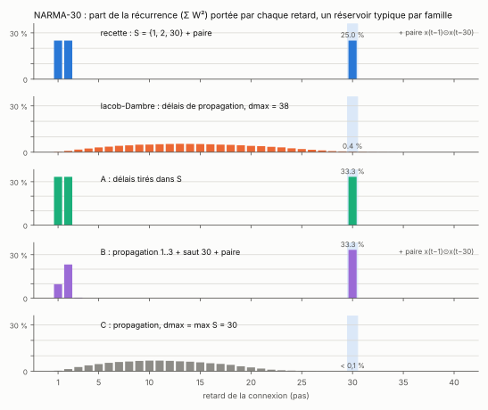

La figure montre la différence de fond. Des positions uniformes dans un carré donnent des délais en cloche, centrés vers un tiers de dmax : avec dmax = 38, le délai 30 porte 0,4 % de la récurrence ; avec dmax = 30 (famille C), moins de 0,1 %. Le délai 1 est presque vide aussi. La recette et A mettent un tiers ou un quart de la récurrence exactement sur 30.

| tâche | ESN à fuite | recette | Iacob-Dambre | A | B | C |
|---|---|---|---|---|---|---|
| NARMA-30 | 0,388 | **0,0042** | 0,334 | 0,0057 | 0,0072 | 0,341 |
| Silverbox | 0,306 | 0,200 | **0,182** | 0,202 | 0,182 | 0,182 |
| Wiener-Hammerstein | 0,0336 | 0,0425 | 0,0287 | **0,0266** | 0,0441 | 0,0275 |
| MNIST lignes, erreur | 10,2 % | **8,5 %** | 9,0 % | 8,8 % | 8,6 % | 8,8 % |
| capacité mémoire (sur 300) | 54,6 | 223,1 | 263,3 | 224,0 | **267,6** | 177,9 |
| NARMA-10 (5 seeds) | 0,118 | 0,091 | 0,119 | **0,083** | 0,111 | 0,117 |
| bande (5 seeds) | **0,037** | 0,044 | 0,059 | 0,048 | 0,080 | 0,055 |
| îlots (5 seeds) | 0,134 | 0,082 | 0,088 | **0,080** | 0,103 | 0,093 |

Pour les noyaux plantés, la colonne « recette » est le S calculé à K = 3 de la partie 3.3, et {1, …, 10} reste devant sur les trois (0,084, 0,036, 0,045).

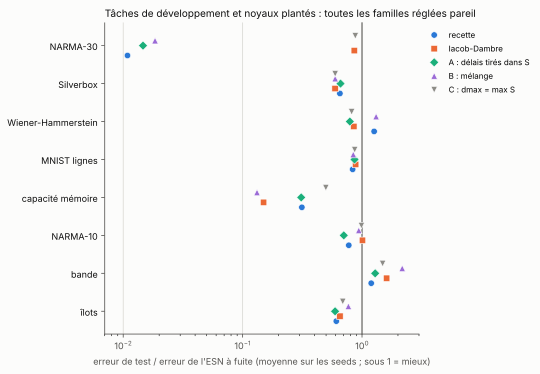

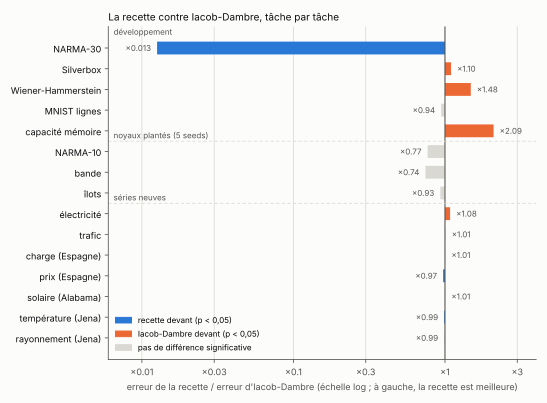

Recette contre Iacob-Dambre, Wilcoxon apparié, sans correction :

| tâche | recette / Iacob | p | devant |
|---|---|---|---|
| NARMA-30 | ×0,013 | 0,002 | recette |
| Silverbox | ×1,10 | 0,002 | Iacob-Dambre |
| Wiener-Hammerstein | ×1,48 | 0,002 | Iacob-Dambre |
| MNIST lignes | ×0,94 | 0,08 | — |
| capacité mémoire (300 − MC) | ×2,09 | 0,01 | Iacob-Dambre |
| NARMA-10, bande, îlots | ×0,77, ×0,74, ×0,93 | ≥ 0,06 | — |

- **NARMA-30 sépare tout.** Les trois familles qui ont un retard 30 net (recette, A, B) font de 0,004 à 0,007. Les deux qui n'ont que des délais de propagation restent à 0,33–0,34, à peine mieux que l'ESN à fuite. Caler dmax sur le spectre (C) ne change rien : la portée y est, mais presque aucune connexion ne l'utilise.
- **Silverbox, WH, capacité mémoire : Iacob-Dambre devant la recette.** Sur Silverbox il fait 0,182, entre la recette (0,200) et le meilleur réservoir à retards de 4.3 (0,163). Sur WH, A fait 0,0266 et Iacob-Dambre 0,0287, mieux que toutes les familles de 4.3 (0,0304 au mieux). Sur la capacité mémoire, Iacob-Dambre (263) égale le meilleur de 4.3 (263,5). Ce sont aussi les trois tâches où, en 4.3, une famille à S cherché battait déjà la recette : des délais nombreux et étalés y valent mieux que peu de sauts.
- **WH : la paire coûte.** Le S calculé y porte la paire (39, 40) sur les 10 seeds, ce qui ramène N à 447. Les deux familles qui l'ont (recette, B) sont les deux qui perdent contre l'ESN à fuite (×1,26 et ×1,31). Les trois sans paire (Iacob, A, C) gagnent de 15 à 21 %.
- **B ne fait pas mieux que ses deux parents.** Il gagne sur la capacité mémoire (267,6, à égalité avec Iacob-Dambre, p = 0,5), est derrière la recette sur NARMA-30 (×1,7, p = 0,004) et derrière Iacob-Dambre sur WH (×1,54, p = 0,002). Quand tous les retards de S sont plus courts que le dmax retenu, B redevient exactement Iacob-Dambre : c'est le cas sur 9 seeds sur 10 pour Silverbox et 8 sur 10 pour la capacité mémoire.
- **A est la famille la plus régulière** : devant l'ESN à fuite sur les cinq tâches de développement (p ≤ 0,012), 35 % au-dessus de la recette sur NARMA-30 (0,0057 contre 0,0042), meilleure famille sur WH.

**Avec leur optimisation par CMA-ES.** Comme dans leur article, les positions sont tirées d'un mélange de 4 gaussiennes dans le plan, et CMA-ES optimise le génome : échelle des poids et connectivité pour chaque paire de groupes, fuite et biais par groupe, moyennes, écarts-types, corrélations et poids du mélange, échelle d'entrée et vitesse de propagation (délai D = min(200, 1 + ⌊v·distance⌋)), soit 66 paramètres. 10 candidats par génération, 16 générations : 160 évaluations sur la validation, contre 60 pour les autres familles. C'est un avantage de réglage, laissé volontairement.

| tâche | positions au hasard | + CMA-ES | CMA-ES / hasard | recette |
|---|---|---|---|---|
| NARMA-30 | 0,334 | 0,228 | ×0,68, p = 0,002 | **0,0042** |
| Silverbox | 0,182 | **0,175** | ×0,96, p = 0,02 | 0,200 |
| Wiener-Hammerstein | 0,0287 | 0,0275 | ×0,96, p = 0,77 | 0,0425 |
| capacité mémoire (sur 300) | 263,3 | **299,9** | 300 − MC : ×0,003, p = 0,002 | 223,1 |

L'optimisation aide nettement sur NARMA-30 et la capacité mémoire, où elle allonge les délais (la portée va jusqu'à 200 pas), un peu sur Silverbox, pas sur WH. Elle ne rattrape pas la recette sur NARMA-30 : sans retard 30 net, 0,228 reste 54 fois au-dessus de 0,0042.

Sur les séries neuves, le même duel donne une égalité presque partout : voir les parties [5.5](5_series_reelles.md#55-contre-iacob-et-dambre-exploratoire) et [5.6](5_series_reelles.md#56-test-4--six-séries-neuves-contre-iacob-et-dambre-et-toutes-les-références).

## 4.7 Les autres places pour un retard

Un retard peut aller dans l'état (la recette), dans l'entrée (ESN + entrées retardées, 4.2), dans la lecture, ou se réduire à une copie de l'état. Quatre références de plus, réglées comme l'ESN à fuite (mêmes tirages de ρ, fuite et échelle d'entrée, 60 évaluations, 10 seeds ; 30 évaluations et 5 seeds sur les noyaux plantés) :

| famille | construction |
|---|---|
| lecture retardée (Holzmann et Hauser, 2010) | ESN à fuite de 632 neurones ; la lecture reçoit [x(t), x(t − τ)] pour τ dans le S calculé par la recette à la même seed. La lecture a jusqu'à K fois plus de variables |
| self-ESN (Xu, Liu et Li, 2024) | x(t) reçoit en plus γ·x(t − m), γ ∈ [0 ; 1], m entier log-uniforme sur [2 ; 200] (2 à 27 pour MNIST) |
| cycle (Rodan et Tiňo, 2011) | W = r·(permutation circulaire), entrées de même amplitude et de signes aléatoires, N = 632 |
| orthogonal | W = ρ·Q, Q orthogonale aléatoire (toutes les valeurs propres de module ρ), N = 632 |

| tâche | ESN à fuite | recette | lecture retardée | self-ESN | cycle | orthogonal |
|---|---|---|---|---|---|---|
| NARMA-30 | 0,388 | **0,0042** | 0,344 | 0,418 | 0,400 | 0,382 |
| Silverbox | 0,306 | **0,200** | 0,253 | 0,335 | 0,271 | 0,271 |
| Wiener-Hammerstein | 0,0336 | 0,0425 | **0,0217** | 0,0394 | 0,0298 | 0,0305 |
| MNIST lignes, erreur | 10,2 % | 8,5 % | **7,2 %** | 9,5 % | 10,6 % | 9,3 % |
| capacité mémoire (sur 300) | 54,6 | **223,1** | 59,6 | 52,2 | 60,3 | 65,4 |
| NARMA-10 (5 seeds) | 0,118 | 0,091 | **0,091** | 0,266 | 0,177 | 0,165 |
| bande (5 seeds) | 0,037 | 0,044 | **0,024** | 0,142 | 0,047 | 0,052 |
| îlots (5 seeds) | 0,134 | 0,082 | **0,058** | 0,287 | 0,131 | 0,133 |

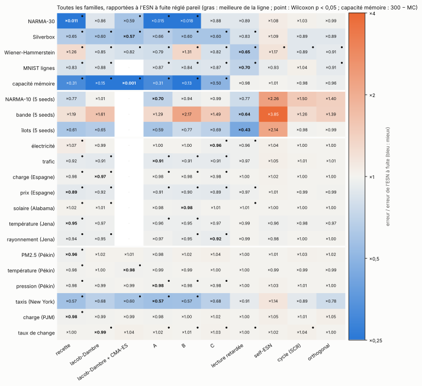

- **La lecture retardée est la référence la plus forte.** Avec le même S que la recette, elle la bat sur WH (×0,51), MNIST (×0,84), la bande et les îlots, fait jeu égal sur NARMA-10, et perd nettement là où l'âge utile est long et isolé (NARMA-30, ×82) et sur la capacité mémoire. Sa lecture a jusqu'à dix fois plus de variables (6 320 sur WH contre 632) : ce n'est pas un budget de lecture égal, mais c'est un budget récurrent égal.
- **Self-ESN, cycle, orthogonal** restent proches de l'ESN à fuite sur les tâches de développement (de ×0,89 à ×1,17) et perdent nettement sur les noyaux plantés (jusqu'à ×3,8 pour le self-ESN sur la bande). Le self-ESN ajoute une copie retardée de l'état (γ·I), soit une tranche identité : c'est probablement le même défaut qu'en 4.1, où les traces de différents âges s'alignent.
- Sur les sept séries des tests 2 et 3 (même réglage, 30 évaluations), ces quatre familles sont à moins de 5 % de l'ESN à fuite. La lecture retardée y fait jeu égal avec la famille C sur l'électricité (0,1616 contre 0,1615, les deux meilleures de l'étude sur cette série).

## Bilan

**Où ça marche.** Réglé comme les autres, avec une fuite, le réservoir à retards bat l'ESN à fuite sur les cinq tâches de développement. Une famille à retards est devant sur Silverbox et MNIST à tous les budgets. La recette donne le meilleur réservoir sur NARMA-30, même avec très peu de connexions ou de données, et aucune des dix autres familles ne l'approche sans retard 30 net.

**Les limites.**
- Sur NARMA-30, un ESN avec les bons âges en entrée fait 4 fois mieux que la recette, et le NG-RC fait aussi bien : la contribution n'est pas l'état de l'art de NARMA-30.
- Des délais de propagation (Iacob et Dambre) battent la recette sur Silverbox, WH et la capacité mémoire, et, optimisés par CMA-ES, ils atteignent presque toute la capacité mémoire possible.
- Le même S donne de meilleurs résultats en lecture qu'en connexions sur WH, MNIST et les noyaux plantés : le calcul de S sert, mais pas forcément pour construire le réservoir.
- Ces tâches ont servi pendant le développement : d'où la partie 5.

**Le lien avec la théorie.** Les tranches identité et les copies d'état (self-ESN) effondrent la mémoire pour la même raison que les réservoirs physiques à retard égal à l'horloge (partie 6) : des chemins différents laissent la même trace. La fuite et les retards jouent des rôles distincts (vitesse d'oubli contre âges atteignables). Les délais de propagation à positions uniformes ont une distribution en cloche qui laisse presque vides les délais longs ; c'est ce qui sépare Iacob-Dambre de la recette sur NARMA-30.

Scripts : `src/p7_1_tranches.py`, `src/p7_2_entree.py`, `src/p7_5_ngrc_min.py`, `src/ngrc.py`, `src/p12_synthese.py` (sous-commandes `equite`, `recette`, `budgets`, `stats`, `figures`), `src/courbes_apprentissage.py`, `src/iacob_dambre.py` et `src/plot_iacob.py` (4.6), `src/references2.py` (4.6 avec CMA-ES et 4.7), `src/plot_figures.py`.

## Références

- Iacob et Dambre, *Exploiting Signal Propagation Delays to Match Task Memory Requirements in Reservoir Computing*, Biomimetics 9(6), 355 (2024), [PMC](https://pmc.ncbi.nlm.nih.gov/articles/PMC11201534/).
- Hansen, *The CMA Evolution Strategy: A Tutorial* (2016), [arXiv:1604.00772](https://arxiv.org/abs/1604.00772).
- Holzmann et Hauser, *Echo state networks with filter neurons and a delay&sum readout*, Neural Networks 23(2), 244–256 (2010).
- Xu, Liu et Li, *Delayed self-feedback echo state network for long-term dynamics of hyperchaotic systems*, Physical Review E 109, 064210 (2024).
- Rodan et Tiňo, *Minimum complexity echo state network*, IEEE Transactions on Neural Networks 22(1), 131–144 (2011).
- White, Lee et Sompolinsky, *Short-term memory in orthogonal neural networks*, Physical Review Letters 92, 148102 (2004).
- Tanaka, Matsumori, Yoshida et Aihara, *Reservoir computing with diverse timescales for prediction of multiscale dynamics*, Physical Review Research 4 (2022) : DTS-ESN.
- Gauthier, Bollt, Griffith et Barbosa, *Next generation reservoir computing*, Nature Communications 12, 5564 (2021) : NG-RC.
- Manneschi, Lin et Vasilaki, *SpaRCe: Improved Learning of Reservoir Computing Systems Through Sparse Representations*, IEEE TNNLS 34 (2023), [arXiv:1912.08124](https://arxiv.org/abs/1912.08124).
- Liste complète : [references.md](references.md).

---

[Sommaire](../README.md#le-rapport) · [← Partie 3](3_calculer_S.md) · [Partie 5 →](5_series_reelles.md)
