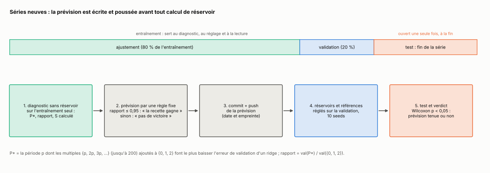
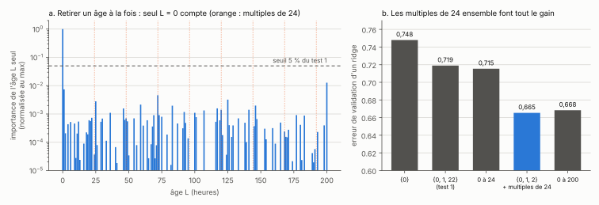
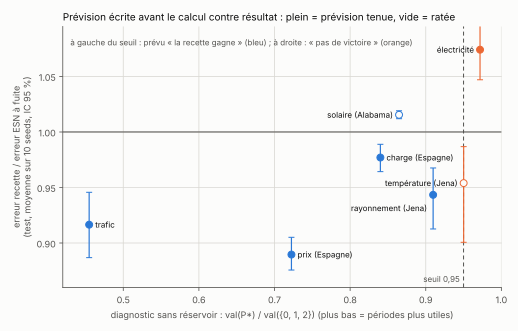
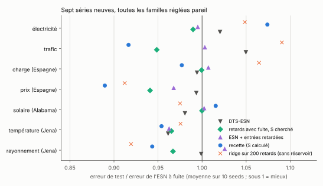
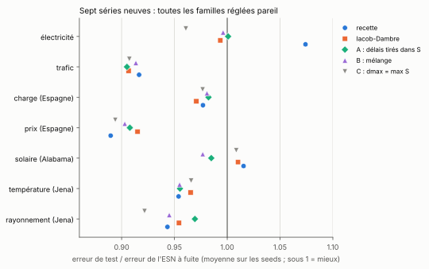
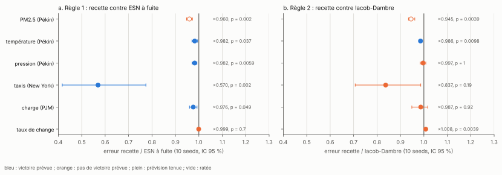

[Sommaire](../README.md#le-rapport) · [← Partie 4](4_comparaisons.md) · [Partie 6 →](6_reservoir_physique.md)

# Partie 5 — Séries neuves, prévisions écrites avant le calcul

> **Ce qu'il faut retenir**
>
> - Les tâches des parties 1 à 4 ont servi pendant tout le développement. Ici, la méthode est testée sur 17 séries réelles jamais regardées auparavant, en quatre tests, avec d'abord, sans réservoir, une prévision par une règle fixe, poussée sur le dépôt avant tout calcul.
> - **Test 1 (4 séries), raté sur ce qui comptait** : le diagnostic âge par âge annonçait une victoire sur ETTh1 et ETTh2, et la recette n'y bat pas l'ESN à fuite. Il ratait l'information portée par les multiples de 24 h.
> - **Tests 2, 3 et 4 (13 séries), diagnostic par périodes** : la recette bat l'ESN à fuite sur 10 séries, de −2 % à −43 %, et la prévision écrite avant est tenue 10 fois sur 13.
> - **Contre Iacob et Dambre**, une règle écrite avant le test 4 (la recette gagne si la période utile dépasse leur portée de 40 pas) est tenue 5 fois sur 6. Mais sur l'ensemble des séries, des délais de propagation sans calcul font presque aussi bien que la recette, et la version optimisée par CMA-ES ne fait pas mieux que les positions au hasard (1 série sur 6, au lieu des 4 prévues).
> - **Un ridge linéaire sur 200 âges, sans réservoir**, bat tous les réservoirs sur 4 des 6 séries du test 4.

## 5.1 Le protocole

- **Prévision** de h pas : entrée u(t) = x(t), cible y(t) = x(t + h). Série normalisée par la moyenne et l'écart-type de l'entraînement seul.
- **Découpe chronologique** : le test est la fin de la série. La validation (20 % finaux de l'entraînement) sert à tout régler, le test n'est ouvert qu'une fois.
- **Diagnostic sans réservoir**, sur l'entraînement seul, puis **prévision par une règle fixée d'avance**, écrite dans un fichier JSON et poussée sur le dépôt (le commit date la prévision). Le script de calcul refuse de démarrer sans ce fichier.
- **Familles** : ESN à fuite, DTS-ESN, retards avec fuite (S cherché dans l'espace a priori de la partie 4), ESN + entrées retardées (S calculé), recette (S calculé). 30 évaluations de réglage chacune sur la validation (60 pour la recette du test 1), 400 000 connexions, 10 seeds. Références sans réservoir : persistance (ŷ(t) = x(t)), ridge sur 200 âges, NG-RC.
- **Verdict** : la recette bat l'ESN à fuite si son erreur moyenne est plus basse et Wilcoxon apparié p < 0,05 sur les 10 seeds.

Chaque série est unique : les 10 seeds ne mesurent que la variance du tirage du réservoir, pas celle des données.

## 5.2 Test 1 : diagnostic âge par âge (4 séries)

**Règle** (pré-enregistrée, [`preenregistrements/test1.md`](preenregistrements/test1.md)) : le spectre de la partie 3 donne un poids w_L à chaque âge ; l'effectif d'âges N_eff = 1 / Σ w_L² mesure si l'information est concentrée sur peu d'âges. Prévision : la recette gagne si N_eff ≤ 6.

| série (horizon) | N_eff | prévision | ESN à fuite | DTS-ESN | recette | ridge 200 âges | verdict |
|---|---|---|---|---|---|---|---|
| ETTh1, température d'huile (24 h) | 2,1 | gagne | 0,711 | **0,684** | 0,695 (p = 0,08) | 0,699 | égalité, **ratée** |
| ETTh2, idem (24 h) | 2,0 | gagne | 0,540 | 0,526 | 0,538 (p = 0,43) | **0,520** | égalité, **ratée** |
| taches solaires mensuelles (12 mois) | 8,3 | pas de victoire | 0,581 | 0,784 | 0,873 (p = 0,014) | **0,528** | perd, tenue |
| températures min. de Melbourne (7 jours) | 14,8 | pas de victoire | 0,652 | **0,642** | 0,648 (p = 0,23) | 0,663 | égalité, tenue |

Deux prévisions tenues sur quatre, mais ratées justement là où une victoire était annoncée. Sur les taches solaires, une seed fait exploser la recette (écart-type 0,71).

## 5.3 Ce qui clochait

ETTh1 a été regardée après coup, sur la validation seulement. Donc c'est exploratoire : ça explique l'échec, ça ne prouve rien.

- **Panneau a.** La cible est la valeur 24 h plus tard, et l'âge 0 (la valeur actuelle) porte 93 % de l'importance. Chaque autre âge pèse au plus 1,3 % du maximum, sous le seuil de 5 % utilisé. Le diagnostic est retombé sur une enveloppe par blocs, concentrée sur les âges 1 à 3. Le N_eff de 2,1 mesurait cette concentration, pas une mémoire nette, et le S calculé, [1, 22], n'atteignait aucun multiple de 24.
- **Panneau b.** Pourtant, ajouter à {0, 1, 2} les multiples de 24 (cycle jour, semaine) fait presque tout le gain d'un ridge sur 200 âges : 0,665 contre 0,668. Huit âges qui pèsent chacun environ 1 %, mais qui ensemble portent l'information. Retirer un âge à la fois ne peut pas le voir.

**La correction : un diagnostic par périodes.** Pour chaque période p de 2 à 100, on ajoute à {0, 1, 2} tous les multiples {p, 2p, 3p, …} jusqu'à 200 et on mesure l'erreur de validation d'un ridge. P\* est la période qui la fait le plus baisser. Le poids va pour moitié aux âges 1 et 2, pour moitié aux multiples de P\*, et S sort du calcul par les sauts (K = 2, 3 et 5). Le diagnostic donne aussi le **rapport** val(P\*) / val({0, 1, 2}) : plus il est bas, plus les périodes apportent.

Sur ETTh1 (exploratoire, déjà ouverte) : P\* = 48, S = {1, 48, 96}, et la recette passe à 0,687 contre 0,711 pour l'ESN à fuite (p = 0,002). Elle reste juste derrière DTS-ESN (0,684). La correction va dans le bon sens, mais ETTh1 ne peut plus servir de test.

## 5.4 Tests 2 et 3 : diagnostic par périodes (7 séries neuves)

**Règle** (pré-enregistrée, [`preenregistrements/test2.md`](preenregistrements/test2.md) puis [`test3.md`](preenregistrements/test3.md), la même pour les deux) : la recette gagne si le rapport est ≤ 0,95, sinon pas de victoire. Deux prévisions secondaires, tirées d'ETTh1 : la recette ne bat ni DTS-ESN ni le ridge sur {0, 1, 2} + multiples de P\*.

| série (horizon 24 h, pas horaire) | source | P\* | rapport | prévision |
|---|---|---|---|---|
| électricité, moyenne de 321 clients | laiguokun/multivariate-time-series-data | 24 | 0,972 | pas de victoire |
| trafic, moyenne de 862 capteurs | idem | 4 | 0,455 | gagne |
| charge électrique, Espagne | darts, `energy_dataset` | 2 | 0,840 | gagne |
| prix de l'électricité, Espagne | idem | 24 | 0,722 | gagne |
| production solaire, Alabama (137 centrales) | laiguokun | 32 | 0,865 | gagne |
| température, Jena 2020 | darts, `weather` | 73 | 0,950 | pas de victoire (juste au-dessus du seuil) |
| rayonnement global, Jena 2020 | idem | 72 | 0,910 | gagne |

Électricité et trafic : 12 000 dernières heures, test sur les 2 880 dernières. Énergie : 12 000 dernières heures. Solaire et Jena : une année entière (≈ 8 760 h, moyennes horaires des mesures à 10 min). Test = 20 % final, au plus 2 880 h.

Erreur de test (NRMSE, moyenne sur 10 seeds) ; p = Wilcoxon de la recette contre l'ESN à fuite :

| série | ESN à fuite | DTS-ESN | retards avec fuite | ESN + entrées retardées | **recette** | ridge périodes | ridge 200 âges | NG-RC | verdict |
|---|---|---|---|---|---|---|---|---|---|
| électricité | 0,168 | 0,172 | **0,166** | 0,167 | 0,181 (p = 0,002) | 0,178 | 0,176 | 0,192 | perd, tenue |
| trafic | 0,265 | 0,278 | 0,252 | 0,266 | **0,243** (p = 0,002) | 0,290 | 0,289 | 0,326 | gagne, tenue |
| charge, Espagne | 0,542 | 0,539 | 0,541 | 0,546 | **0,529** (p = 0,004) | 0,577 | 0,577 | 0,603 | gagne, tenue |
| prix, Espagne | 0,645 | 0,641 | 0,607 | 0,625 | **0,574** (p = 0,002) | 0,585 | 0,589 | 0,704 | gagne, tenue |
| solaire, Alabama | 0,464 | 0,455 | 0,463 | 0,465 | 0,471 (p = 0,002) | **0,450** | 0,452 | 0,478 | perd, **ratée** |
| température, Jena | 0,619 | 0,595 | 0,597 | 0,596 | **0,590** (p = 0,002) | 0,597 | 0,604 | 0,597 | gagne, **ratée** |
| rayonnement, Jena | 0,616 | 0,615 | 0,595 | 0,631 | 0,581 (p = 0,002) | 0,575 | **0,566** | 0,704 | gagne, tenue |

**Prévision principale : 5 sur 7.**

- **Ce qui est tenu.** Les quatre victoires annoncées sur trafic, charge, prix et rayonnement, et la défaite annoncée sur l'électricité. Le prix de l'électricité est le meilleur cas : −11 % contre l'ESN à fuite, et devant toutes les autres familles et les deux ridges.
- **Solaire : annoncé comme une victoire, c'est une défaite.** La production d'un parc solaire a un cycle journalier très net, et un ridge sur les périodes fait mieux que tous les réservoirs (0,450). La recette est derrière DTS-ESN.
- **Température de Jena : annoncée sans victoire (rapport 0,950, à la limite), la recette gagne de 4,6 %.** Mais surtout parce que l'ESN à fuite y est instable (écart-type 0,054 sur les seeds, contre 0,0006 pour la recette). DTS-ESN, l'ESN à entrées retardées et même la persistance (0,596) font presque aussi bien. Ce gain n'est pas compté comme un effet des retards calculés.

**Prévisions secondaires : trop prudentes.** La prévision disait que la recette ne battrait ni DTS-ESN ni le ridge sur périodes. Elle bat DTS-ESN sur 5 séries sur 7 (tenue seulement sur l'électricité et le solaire) et le ridge sur périodes sur 4 sur 7 (trafic, charge, prix, température).

## 5.5 Contre Iacob et Dambre (exploratoire)

Les mêmes quatre familles qu'en [4.6](4_comparaisons.md#46-contre-iacob-et-dambre-2024-et-trois-mélanges), sur les sept séries des tests 2 et 3 : 30 évaluations de réglage, 10 seeds, S calculé lu dans la recette à la même seed. Ces familles ont été lancées après les tests, sans prévision écrite : ce n'est pas un test pré-enregistré.

| série | ESN à fuite | recette | Iacob-Dambre | A | B | C |
|---|---|---|---|---|---|---|
| électricité | 0,168 | 0,181 | 0,167 | 0,168 | 0,167 | **0,162** |
| trafic | 0,265 | 0,243 | 0,240 | **0,240** | 0,242 | 0,241 |
| charge, Espagne | 0,542 | 0,529 | **0,526** | 0,532 | 0,531 | 0,529 |
| prix, Espagne | 0,645 | **0,574** | 0,591 | 0,586 | 0,583 | 0,577 |
| solaire, Alabama | 0,464 | 0,471 | 0,468 | 0,457 | **0,453** | 0,468 |
| température, Jena | 0,619 | **0,590** | 0,597 | 0,591 | 0,591 | 0,598 |
| rayonnement, Jena | 0,616 | 0,581 | 0,588 | 0,597 | 0,582 | **0,568** |

| famille | rapport moyen à l'ESN à fuite | gagne (p < 0,05) | perd (p < 0,05) |
|---|---|---|---|
| recette | 0,967 | 5 | 2 (électricité, solaire) |
| Iacob-Dambre | 0,959 | 4 | 1 (solaire, ×1,010) |
| A | 0,958 | 4 | 0 |
| B | 0,953 | 5 | 0 |
| C | 0,948 | 5 | 0 |

- **Sur les séries, tout réservoir à délais gagne 3 à 5 % sur l'ESN à fuite**, et les cinq familles sont à moins de 2 % l'une de l'autre en moyenne. La recette a le rapport moyen le moins bon, et c'est la seule qui perd deux fois.
- **Recette contre Iacob-Dambre** : devant sur le prix (×0,972, p = 0,006) et la température (×0,988, p = 0,002), derrière sur l'électricité (×1,081, p = 0,002), égalité sur les quatre autres. Le gain de la recette sur le trafic (−8 %) et la charge (−2 %) ne vient donc pas du calcul de S : des délais de propagation font pareil.
- **C, dmax = max S, a le meilleur rapport moyen** (0,948) et ne perd jamais. Le plus grand retard de S va de 14 à 144 pas selon la série et la seed ; C étale ses délais sur cette portée sans en placer aucun exactement. Sur NARMA-30, la même construction échouait parce qu'un âge précis compte, pas une plage.
- **B gagne seulement sur le solaire** (0,453, devant la recette ×0,962, p = 0,010, et devant Iacob-Dambre ×0,967, p = 0,014), la série où la recette perdait.

Le verdict de 5.4 ne change pas : sur 5 séries sur 7, des retards battent l'ESN à fuite, et le diagnostic par périodes l'annonçait. Ce qui change, c'est l'interprétation : sur ces séries, le placement exact des retards calculés n'apporte rien de mesurable par rapport à des délais étalés sur la bonne portée.

## 5.6 Test 4 : six séries neuves, contre Iacob et Dambre et toutes les références

**Pourquoi.** La partie 5.5 montre, après coup, que des délais de propagation font aussi bien que la recette sur les séries des tests 2 et 3. Le test 4 pose la question sur des séries jamais ouvertes, avec une règle écrite avant ([`preenregistrements/test4.md`](preenregistrements/test4.md), prévisions dans `results/prereg_v4.json`, commit `685ef5f`).

**Les règles.**
1. **Règle 1, inchangée** depuis les tests 2 et 3 : la recette bat l'ESN à fuite si le rapport du diagnostic est ≤ 0,95.
2. **Règle 2, nouvelle** : la recette bat Iacob-Dambre (positions au hasard) si P\* > 40 et si le rapport est ≤ 0,95. Le dmax d'Iacob-Dambre ne dépasse pas 40 et leurs délais se concentrent vers un tiers de dmax (partie 4.6) : une période plus longue ne s'atteint qu'en plusieurs sauts, alors que la recette la place exactement. La condition sur le rapport a été ajoutée après un premier passage du diagnostic (le taux de change donnait P\* = 100 sans aucun gain des périodes), avant tout calcul de réservoir ; c'est écrit dans le protocole.
3. **Secondaire** : Iacob-Dambre + CMA-ES bat les positions au hasard sur au moins 4 séries sur 6.

**Les séries**, même découpe que le test 3 (12 000 derniers pas, horizon 24 pas, test sur les 2 880 derniers pas ou 20 % de la série) :

| série | source | pas | P\* | rapport | règle 1 | règle 2 |
|---|---|---|---|---|---|---|
| PM2.5, Pékin | `jbrownlee/Datasets`, `pollution.csv` | 1 h | 40 | 0,992 | pas de victoire | pas de victoire |
| température, Pékin | idem | 1 h | 96 | 0,874 | gagne | **gagne** |
| pression, Pékin | idem | 1 h | 6 | 0,882 | gagne | pas de victoire |
| taxis, New York | `numenta/NAB`, `nyc_taxi.csv` | 1 h (somme des demi-heures) | 2 | 0,575 | gagne | pas de victoire |
| charge électrique, PJM Est | `panambY/Hourly_Energy_Consumption` | 1 h | 24 | 0,901 | gagne | pas de victoire |
| taux de change, première devise | `laiguokun/multivariate-time-series-data` | 1 jour | 100 | 1,008 | pas de victoire | pas de victoire |

**Les familles** : ESN à fuite, recette, Iacob-Dambre et ses trois mélanges, Iacob-Dambre + CMA-ES (160 évaluations), lecture retardée, self-ESN, cycle, orthogonal (30 évaluations chacune), 10 seeds, plus persistance et ridges sans réservoir.

| série | ESN à fuite | **recette** | Iacob-Dambre | + CMA-ES | A | lecture retardée | ridge 200 âges |
|---|---|---|---|---|---|---|---|
| PM2.5, Pékin | 0,996 | 0,956 | 1,012 | 1,009 | 0,974 | 0,996 | **0,919** |
| température, Pékin | 0,383 | 0,376 | 0,382 | **0,374** | 0,379 | 0,382 | 0,377 |
| pression, Pékin | 0,775 | 0,761 | 0,764 | 0,768 | 0,759 | 0,775 | **0,754** |
| taxis, New York | 0,955 | 0,544 | 0,650 | 0,573 | 0,543 | 0,870 | **0,521** |
| charge, PJM | 0,476 | 0,465 | 0,471 | 0,473 | 0,467 | 0,475 | **0,456** |
| taux de change | 0,2011 | 0,2009 | **0,1994** | 0,2085 | 0,2042 | 0,2002 | 0,2014 |

- **Règle 1 : tenue 5 fois sur 6.** La recette bat l'ESN à fuite sur les quatre séries annoncées (de −1,8 % à −43 % ; p = 0,037 sur la température et 0,049 sur la charge, à la limite), et fait jeu égal sur le taux de change, comme annoncé. La prévision ratée est PM2.5 : annoncée sans victoire (rapport 0,992), la recette y gagne de 4 % (p = 0,002). La règle était trop prudente.
- **Règle 2 : tenue 5 fois sur 6.** La seule victoire annoncée, la température de Pékin (P\* = 96), est tenue, de 1,4 % (p = 0,010). Égalité, comme annoncé, sur la pression, les taxis et la charge ; défaite sur le taux de change (×1,008, p = 0,004). Raté : PM2.5, où la recette bat Iacob-Dambre de 5,5 % sans que la règle l'annonce.
- **Secondaire : raté.** CMA-ES ne bat les positions au hasard que sur la température de Pékin (×0,980, p = 0,004) ; il est pire sur le taux de change (×1,046). Sur ces séries, l'optimisation de la géométrie n'apporte rien de systématique.
- **Le ridge sans réservoir est le meilleur sur 4 séries sur 6** (PM2.5, pression, taxis, charge). Sur ces séries, les retards aident un réservoir, mais un réservoir n'ajoute presque rien à une régression linéaire sur les mêmes âges.
- **A**, l'architecture d'Iacob-Dambre avec les délais tirés dans le S de la recette, fait jeu égal avec la recette partout sauf sur le taux de change.

## Bilan

**Où ça marche.** Avec le diagnostic par périodes, sur 13 séries neuves et une règle écrite avant le calcul, la recette bat l'ESN à fuite 10 fois, et la prévision est tenue 10 fois sur 13. La règle qui prévoit quand la recette bat des délais de propagation est tenue 5 fois sur 6 sur le seul test où elle a été écrite avant. Meilleurs cas : le prix de l'électricité en Espagne (−11 %, devant toutes les familles et les ridges) et les taxis de New York (−43 % contre l'ESN à fuite, très instable sur cette série).

**Les limites.**
- Les gains sont petits : de 2 à 11 % sur la plupart des séries.
- Des délais de propagation sans calcul font presque aussi bien que la recette sur l'ensemble des séries (5.5, 5.6), et un ridge linéaire sur les mêmes âges fait souvent mieux que tous les réservoirs (test 4).
- Le seuil de 0,95 et le diagnostic par périodes viennent d'ETTh1 et ETTh2 ; la règle 2 vient des sept séries de 5.5, et sa condition sur le rapport a été ajoutée après un premier passage du diagnostic (avant tout réservoir).
- Les P\* trouvés (2, 4, 32, 72, 73…) ne sont pas toujours des cycles lisibles : la grille retient une période dont les multiples recouvrent plusieurs cycles. Le diagnostic marche comme un seuil sur le gain d'un ridge à âges périodiques, pas comme un détecteur de cycle.
- Électricité (test 2) : un essai du code, lancé avant la prévision, a affiché des erreurs sur une fin de série qui recouvre le test. La prévision ne dépend que de l'entraînement, et c'est noté dans le pré-enregistrement.
- Une seule réalisation par série : les seeds ne mesurent que la variance du tirage du réservoir.

**Le lien avec la théorie.** Le diagnostic par périodes est la version « bloc » du spectre de la partie 3 : il mesure l'information portée par un ensemble d'âges ({P\*, 2P\*, …}) que l'ablation âge par âge ne voit pas, parce que chaque âge pris seul est redondant avec les autres. La règle 2 applique la partie 4.6 : des délais en cloche sur [1 ; 40] atteignent mal un âge précis au-delà de 40.

Scripts : `src/reel_nouveau.py` (test 1), `src/reel_corrige.py` (diagnostic par périodes, exploration sur ETTh1), `src/reel_v2.py` (test 2), `src/reel_v3.py` (test 3), `src/reel_v4.py` (test 4), chacun avec les sous-commandes `diagnostic`, `run`, `tableau` ; `src/plot_reel.py`, `src/plot_figures.py` ; `src/iacob_dambre.py`, `src/references2.py` et `src/plot_iacob.py` (5.5). Prévisions : `results/prereg_reel.json`, `prereg_v2.json`, `prereg_v3.json`, `prereg_v4.json`. Les données sont téléchargées depuis GitHub au premier lancement.

## Références

- Zhou, Zhang, Peng, Zhang, Li, Xiong et Zhang, *Informer: Beyond Efficient Transformer for Long Sequence Time-Series Forecasting*, AAAI (2021), [arXiv:2012.07436](https://arxiv.org/abs/2012.07436) : ETTh1 et ETTh2.
- Lai, Chang, Yang et Liu, *Modeling Long- and Short-Term Temporal Patterns with Deep Neural Networks*, SIGIR (2018), [arXiv:1703.07015](https://arxiv.org/abs/1703.07015) : électricité, trafic, solaire, taux de change.
- Herzen et al., *Darts: User-Friendly Modern Machine Learning for Time Series*, Journal of Machine Learning Research 23 (2022) : énergie en Espagne, météo de Jena.
- Liang, Zou, Guo, Li, Zhang, Zhang, Huang et Chen, *Assessing Beijing's PM2.5 pollution: severity, weather impact, APEC and winter heating*, Proceedings of the Royal Society A 471 (2015) : PM2.5, température et pression de Pékin.
- Lavin et Ahmad, *Evaluating Real-time Anomaly Detection Algorithms — the Numenta Anomaly Benchmark*, IEEE ICMLA (2015), [arXiv:1510.03336](https://arxiv.org/abs/1510.03336) : taxis de New York.
- PJM Interconnection, consommation horaire PJM Est, republiée dans le dépôt `panambY/Hourly_Energy_Consumption`.
- Iacob et Dambre (2024), voir la [partie 4](4_comparaisons.md#références).
- Liste complète : [references.md](references.md).

---

[Sommaire](../README.md#le-rapport) · [← Partie 4](4_comparaisons.md) · [Partie 6 →](6_reservoir_physique.md)
