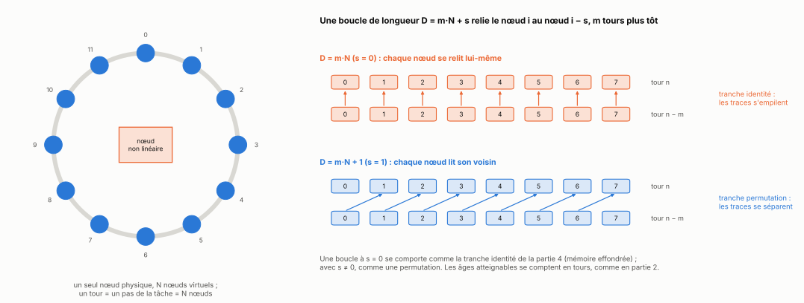
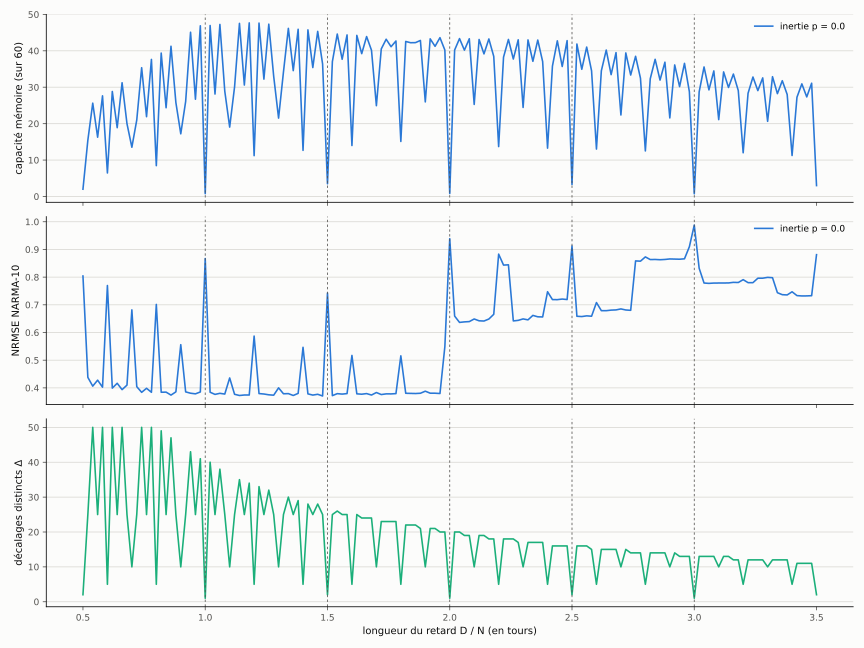
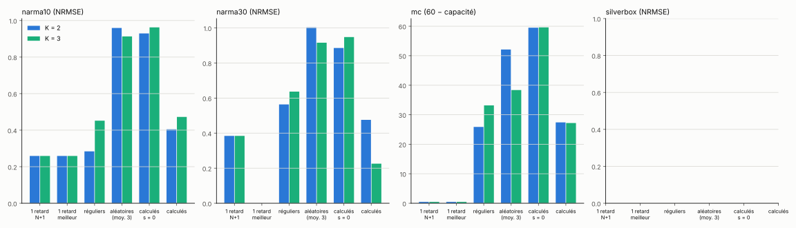

[Sommaire](../README.md#le-rapport) · [← Partie 5](5_series_reelles.md) · [Partie 7 →](7_bilan.md)

# Partie 6 — Un réservoir physique à un seul nœud



> **Ce qu'il faut retenir**
>
> - Un réservoir à retard physique n'a qu'un nœud non linéaire, multiplexé en N nœuds virtuels le long d'une boucle. Une boucle de longueur D = m·N + s relie le nœud i au nœud i − s, m tours plus tôt.
> - Avec une seule boucle, la capacité mémoire s'effondre exactement aux rapports D/N simples : 0,8 sur 60 à D = N, contre 46,9 à D = N ± 1. Elle suit le nombre Δ de décalages distincts, calculé sans simulation. C'est l'effondrement de la tranche identité de la partie 4.
> - Sur NARMA-10, l'erreur saute dès que D dépasse 2N : le tour précédent n'est plus atteignable. C'est la règle de la partie 2.
> - Avec plusieurs boucles au même gain total, les retards calculés battent les retards aléatoires et les boucles alignées sur l'horloge. Ils ne battent la boucle unique N + 1 que sur NARMA-30 (0,226 contre 0,384 à N = 200).

## 6.1 Le modèle

Le temps fin g = n·N + i compte le tour n (un pas de la tâche) et le nœud virtuel i. Modèle discret standard (Appeltant et al., 2011 ; Köster et al., 2021) :

```
z[g] = p·z[g−1] + (1 − p)·tanh( η·m_i·u(n) + Σ_k β_k·z[g − D_k] )
```

- m_i ∈ {−1, +1} : masque d'entrée aléatoire ; u(n) est tenu pendant tout le tour n.
- p : inertie du nœud (retenue nulle partout au calibrage).
- D_k = m_k·N + s_k : la boucle k relie le nœud i au nœud i − s_k, m_k tours plus tôt.
- Lecture : ridge sur les N nœuds du tour n.

Les boucles ne coûtent rien en paramètres : le seul budget physique est N. Deux quantités se calculent sans simulation : h(L), le nombre minimal de boucles pour qu'une entrée du tour n − L atteigne un nœud du tour n, et Δ, le nombre de décalages distincts (modulo N) par lesquels les âges 1 à 40 arrivent sur les nœuds. Avec D = N, toutes les traces arrivent sur les mêmes nœuds et Δ = 1.

## 6.2 Une seule boucle

D de N/2 à 3,5·N par pas de 1, N = 50, 5 seeds.



| D | D/N | Δ | capacité (sur 60) |
|---|---|---|---|
| 49 et 51 | 0,98 et 1,02 | 41 et 40 | 46,9 |
| 50 | 1 | 1 | 0,8 |
| 25, 75, 125, 175 | 0,5, 1,5, 2,5, 3,5 | 2 | 2,0 à 3,5 |
| 100, 150 | 2, 3 | 1 | 0,7 à 0,8 |
| 30, 40, 60, 70, 80, 90 | cinquièmes | 5 | 6,5 à 15,1 |

- **La capacité suit Δ** : corrélation de rang 0,62 sur les 151 longueurs, de 0,70 à 0,93 par tranche de longueurs. Ce sont les creux décrits par Stelzer et al. (2020), quand retard et horloge sont dans un rapport rationnel simple ; Δ en donne une mesure arithmétique.
- **NARMA-10 suit la règle des âges atteignables.** Le nœud i du tour n lit le temps fin n·N + i − D, qui tombe dans le tour n − 1 seulement si D ≤ N + i. Il existe donc un nœud qui lit le tour précédent (donc u(n − 1)) seulement si D ≤ 2N − 1. Mesuré : l'erreur reste vers 0,38 pour D < 2N (hors creux résonants) et ne redescend jamais sous 0,63 au-delà.

## 6.3 Plusieurs boucles

Pour K = 2 et 3 boucles : des retards réguliers (N + 1, 2N + 1, …), trois tirages aléatoires, des retards calculés par la règle des sauts à partir du spectre de la tâche, et les mêmes retards ramenés à s = 0. Le gain de chaque boucle est β/K : le gain total Σ β_k vaut β, comme pour la boucle unique. (Avec des gains β/√K, Σ β_k dépasse 1 et le réservoir sature : voir les fausses pistes.)

À N = 50 :

| tâche, K | une boucle N + 1 | réguliers | aléatoires | calculés, s = 0 | calculés |
|---|---|---|---|---|---|
| NARMA-10, K = 2 | 0,384 | **0,370** | 0,959 | 0,929 | 0,470 |
| NARMA-30, K = 3 | 0,405 | 0,672 | 0,937 | 0,948 | **0,409** |
| 60 − capacité, K = 2 | **13,1** | 30,1 | 53,4 | 59,5 | 40,6 |
| Silverbox, K = 3 | 0,534 | **0,409** | 0,834 | 0,984 | 0,873 |

- **Les boucles décalées comptent** : ramener les retards calculés à s = 0 (des multiples de N, donc des tranches identité, Δ = 1) les détruit.
- **Les retards aléatoires échouent presque toujours** : ils n'ont que 3 à 18 décalages distincts, et l'erreur reste vers 0,9 à 1,0.
- **Calculés contre réguliers** : les calculés gagnent sur NARMA-30, où il faut atteindre un âge de 30 tours en peu de boucles. Ils perdent sur NARMA-10, la capacité et Silverbox (spectre plat, partie 3).
- **Tolérance** : décaler un retard calculé de ±1 ou ±2 ne fait pas tomber dans une résonance (0,335 à 0,491 sur NARMA-30), alors qu'une boucle unique D = N s'effondre (0,929 contre 0,405).

Avec plus de nœuds virtuels (mêmes réglages) :

| tâche | N | une boucle N + 1 | réguliers K = 2 | calculés K = 3 |
|---|---|---|---|---|
| NARMA-10 | 200 | **0,259** | 0,284 | 0,473 |
| NARMA-30 | 50 | 0,405 | 0,600 | 0,409 |
| NARMA-30 | 100 | 0,385 | 0,579 | 0,303 |
| NARMA-30 | 200 | 0,384 | 0,564 | **0,226** |
| 60 − capacité | 200 | **0,47** | 25,9 | 27,2 |



Sur NARMA-30, les trois retards calculés ({199, 202, 6 001} à N = 200 : un tour, un tour, trente tours, avec 87 décalages distincts) battent la boucle unique dès N = 100, et l'écart grandit avec N. Sur NARMA-10 et la capacité, la boucle unique reste meilleure et progresse plus vite avec N.

## Bilan

**Où ça marche.** Les deux règles de l'étude passent au réservoir physique sans changement : la règle des âges atteignables dit où le tour précédent cesse d'être lisible (D ≥ 2N), et Δ, calculé sans simulation, dit où la mémoire s'effondre. Trois boucles calculées battent la boucle unique sur la tâche qui demande un âge ancien.

**Les limites.** Le gain des boucles calculées n'existe que sur NARMA-30. Le réservoir est simulé avec un tanh et sans bruit, N va jusqu'à 200, 5 seeds, une seule répartition des gains testée. Pour un vrai réservoir physique, il faudrait une non-linéarité de nœud standard (Mackey-Glass ou Ikeda), du bruit, et la comparaison chiffrée à la fonction mémoire de Köster et al. (2021).

**Le lien avec la théorie.** Une boucle à D = m·N est une tranche identité (partie 4.1), une boucle décalée une permutation : les creux de Stelzer et al. (2020) sont l'effondrement des tranches identité. Δ en donne une mesure arithmétique, et la perte du tour précédent à D = 2N est la règle des âges atteignables comptée en tours.

Scripts : `src/p10_tdr.py` (sous-commandes `calibrer`, `balayage`, `conception somme`, `tolerance somme`, `figures` ; `P10_N=200` pour changer N).

## Références

- Appeltant et al., *Information processing using a single dynamical node as complex system*, Nature Communications 2, 468 (2011).
- Stelzer, Röhm, Lüdge et Yanchuk, *Performance boost of time-delay reservoir computing by non-resonant clock cycle*, Neural Networks 124 (2020), [arXiv:1905.02534](https://arxiv.org/abs/1905.02534).
- Köster, Yanchuk et Lüdge, *Master memory function for delay-based reservoir computers with single-variable dynamics* (2021), [arXiv:2108.12643](https://arxiv.org/abs/2108.12643).
- Tavakoli et Longtin, *Boosting reservoir computer performance with multiple delays*, Physical Review E 109, 054203 (2024), [APS](https://link.aps.org/doi/10.1103/PhysRevE.109.054203).
- Liste complète : [references.md](references.md).

---

[Sommaire](../README.md#le-rapport) · [← Partie 5](5_series_reelles.md) · [Partie 7 →](7_bilan.md)
