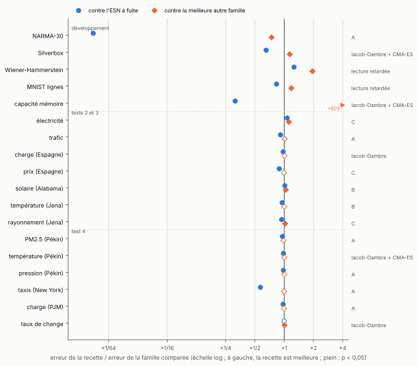

[Sommaire](../README.md#le-rapport) · [← Partie 6](6_reservoir_physique.md)

# Partie 7 — Bilan

> **Ce qu'il faut retenir**
>
> - Ce qui tient : une règle exacte sur les âges qu'un réservoir à retards peut contenir, sa réciproque générique, une borne de sensibilité par le nombre de sauts, et une recette qui calcule S sans réservoir et bat l'ESN à fuite sur 10 des 13 séries neuves où elle a été testée avec une prévision écrite avant.
> - Ce qui ne tient pas : la recette n'est pas une meilleure architecture. Des délais de propagation, une lecture retardée ou un ridge sur les mêmes âges font aussi bien ou mieux partout, sauf là où l'âge utile est long et isolé (NARMA-30).

## Ce qui marche

- **Une règle exacte, et sa réciproque** (partie 2) : x(t) ne contient u(t − L) que si L est une somme d'éléments de S, et, pour presque tous les poids, il contient bien chacun de ces âges. La règle explique les ablations (retard 1 vital sur NARMA, falaise entre {1, 15} et {1, 16}, dents de scie), et les paliers qu'elle prévoit sont exactement des planchers d'information (0,0015, 0,757, 0,997 sur NARMA-30).
- **Une borne par le nombre de sauts** (partie 2.3) : dans un réseau contractant, la sensibilité à l'âge L est bornée par s^{h_S(L)}. Mesurée, elle suit le nombre de sauts avec une corrélation de rang de −0,92 à −1,00.
- **Calculer S au lieu de le chercher** (partie 3) : un spectre de retards mesuré sans réservoir, puis le S qui atteint les âges utiles en un minimum de sauts. {1, 30} sur NARMA-30, 9 fois mieux que l'élagage glouton, zéro réservoir entraîné pour le trouver. La recette complète fait 0,0042, et reste sous 0,008 dès 25 000 connexions.
- **À réglage égal, contre l'ESN à fuite** (partie 4) : le réservoir à retards avec fuite gagne sur les cinq tâches de développement, significativement sur les cinq.
- **Sur des séries neuves, avec la prévision écrite avant** (partie 5) : avec le diagnostic par périodes, la recette bat l'ESN à fuite sur 10 séries sur 13, et la prévision est tenue 10 fois sur 13. La règle qui prévoit quand elle bat des délais de propagation est tenue 5 fois sur 6.
- **Les retards longs et isolés demandent un calcul** (parties 4.6 et 4.7) : sur NARMA-30, les familles qui ont un retard 30 net dans l'état font de 0,004 à 0,007 ; les délais de propagation restent au-dessus de 0,22, même optimisés par CMA-ES, et le même retard placé dans la lecture ne sert à rien (0,344). Seul un accès direct par l'entrée fait mieux (0,0010).
- **Ça passe au réservoir physique** (partie 6) : la même règle dit où un réservoir à un nœud perd le tour précédent (D ≥ 2N), et le nombre de décalages distincts, calculé sans simulation, dit où sa mémoire s'effondre (D/N simple).
- **Une tranche de retard peut être gratuite** (partie 4.1) : une permutation aléatoire fait aussi bien qu'une matrice dense. Une identité, non : les traces s'alignent, comme dans les résonances des réservoirs physiques.

## Ce qui ne marche pas

- **Les tâches à mémoire courte** (Hénon, NARMA-10, Santa Fe) : à énergie de mémoire constante, chaque retard ajouté en retire aux âges récents (partie 2.8).
- **Les spectres étalés** : {1, …, 10} bat le S calculé, de 1,2 à 2,4 fois (partie 3). Le critère des sauts compte le plus court chemin vers chaque âge, pas le nombre de chemins.
- **Quand les bons âges sont connus**, les donner en entrée suffit : sur NARMA-30, un ESN avec u(t − 30) en entrée fait 0,0010, quatre fois mieux que la recette, et le NG-RC fait aussi bien qu'elle (partie 4).
- **Contre d'autres façons de placer un retard** (parties 4.6, 4.7, 5.5, 5.6) : Iacob-Dambre bat la recette sur Silverbox, WH et la capacité mémoire ; la lecture retardée la bat sur WH et MNIST ; sur les séries, les délais de propagation font jeu égal, et un ridge linéaire sur 200 âges bat tous les réservoirs sur 4 des 6 séries du test 4.
- **Les prévisions ne sont pas fiables à 100 %** (partie 5) : le diagnostic âge par âge a raté ETTh1 et ETTh2 ; le diagnostic par périodes s'est trompé sur 3 séries sur 13 (solaire, température de Jena, PM2.5) ; la prévision secondaire du test 4 (CMA-ES devant sur 4 séries) est ratée.
- **Les mélanges** des deux approches (propagation près, sauts calculés loin) ne battent le meilleur de leurs deux parents que sur le solaire.
- **Les gains sont petits** sur WH et MNIST contre l'ESN à fuite (−9 % et −10 %) et sur les séries réelles (2 à 11 %, sauf les taxis).

## Les limites

- Les tâches des parties 1 à 4 ont servi tout au long du développement. Les seules données vraiment neuves sont les 17 séries des tests de la partie 5, et le seuil de leur règle vient d'ETTh1 et ETTh2.
- Les comparaisons à Iacob et Dambre et aux autres références sur les tâches de développement et les séries des tests 2 et 3 sont exploratoires ; seul le test 4 les a pré-enregistrées.
- La version CMA-ES d'Iacob-Dambre a 160 évaluations, contre 30 à 60 pour les autres familles, et une portée de 200 pas : c'est un avantage pour elle. La lecture retardée a une lecture jusqu'à dix fois plus grande.
- Chaque série réelle est unique : 10 seeds de réservoir, une seule réalisation des données.
- Le champ moyen de la partie 2 est une heuristique de forme (erreur de 31 à 49 % sur les valeurs) ; la borne de la partie 2.3 est rigoureuse mais lâche, et n'est utile que pour des réseaux contractants.
- Le réservoir physique est simulé (tanh, sans bruit, N ≤ 200).

## Position par rapport à l'existant

**Ce qui existe.**
- *La règle.* Que les âges atteignables soient les sommes d'éléments de S est un fait élémentaire : c'est l'ensemble des longueurs de chemins dans un graphe dont les arêtes portent des retards, objet classique de la théorie des matrices primitives (exposants, nombre de Frobenius).
- *Le critère des sauts.* Le nombre minimal de sauts correspond au « recurrent skip coefficient » de Zhang et al. (2016) et à la « mean recurrent length » des Dilated RNN (Chang et al., 2017), définis pour des RNN entraînés et motivés par le gradient. Les RNN NARX et les MIST RNN utilisent la même idée de chemin court vers les entrées anciennes.
- *L'architecture.* Iacob et Dambre (2024) : un ESN à fuite où chaque délai de propagation a sa matrice creuse, avec l'observation qu'un âge ancien s'atteint par plusieurs sauts. Le self-ESN de Xu, Liu et Li (2024) : un seul retard à gain scalaire.
- *Les réservoirs à retard physique.* Les résonances quand le retard et l'horloge sont dans un rapport simple (Stelzer et al., 2020), la fonction mémoire d'un seul retard (Köster et al., 2021), plusieurs retards (Tavakoli et Longtin, 2024).
- *La théorie des réservoirs à retards.* Mullarkey et Marzen (2025) calculent des fonctions mémoire de réservoirs linéaires à retards 1 à 3 ; Clabaut et al. (2026) proposent un cadre théorique des réservoirs à un retard. Aucun des deux ne formule de règle d'atteignabilité ni de borne par les sauts.

**Ce qui n'a pas été trouvé ailleurs** (recherche par moteurs généralistes, non exhaustive) :
- l'usage de la règle pour prévoir des planchers d'information et des résultats d'ablation (partie 2) ;
- une borne de sensibilité en nombre de sauts pour un réseau non linéaire à retards multiples (théorème 2) ;
- la mémoire d'un réseau aléatoire à retards multiples comme équation de renouvellement, avec la conservation de l'énergie totale (partie 2.8) ;
- le calcul de S à partir du spectre de retards de la tâche, sans recherche, et sa validation pré-enregistrée sur des séries neuves (parties 3 et 5) ;
- le lien entre l'effondrement des tranches identité, la résonance des réservoirs à retard physique et la diversité des décalages Δ calculée sans simulation (parties 4 et 6) ;
- la comparaison à budget de connexions strictement égal et à réglage égal entre la recette, Iacob-Dambre (avec CMA-ES), la lecture retardée, le self-ESN, le cycle et l'orthogonal.

## La suite

- **Un meilleur critère.** Remplacer h_S(L) par l'énergie de renouvellement e_S(L), qui compte tous les chemins et la dilution ρ/√K : ça devrait favoriser {1, …, 10} sur les spectres étalés et les petits S sur les spectres à pics. À pré-enregistrer.
- **Le S calculé dans la lecture.** La lecture retardée avec le S de la recette est la référence la plus forte sur WH et MNIST : à comparer à lecture de taille égale, et à tester sur des séries neuves.
- **Plus de séries neuves**, avec les deux règles inchangées, pour savoir si 10 sur 13 et 5 sur 6 tiennent, et avec le ridge sans réservoir comme référence systématique.
- **Une borne utile hors du régime contractant**, avec le rayon spectral au lieu de la norme d'opérateur, ou en moyenne sur les tirages.
- **Réservoir physique** : nœud Mackey-Glass ou Ikeda, bruit, comparaison à la fonction mémoire de Köster et al. (2021).

## Références

- Zhang, Wu, Che, Lin, Memisevic, Salakhutdinov et Bengio, *Architectural Complexity Measures of Recurrent Neural Networks*, NeurIPS (2016), [arXiv:1602.08210](https://arxiv.org/abs/1602.08210).
- Chang et al., *Dilated Recurrent Neural Networks*, NeurIPS (2017), [arXiv:1710.02224](https://arxiv.org/abs/1710.02224).
- Brualdi et Ryser, *Combinatorial Matrix Theory*, Cambridge University Press (1991).
- Iacob et Dambre, *Exploiting Signal Propagation Delays to Match Task Memory Requirements in Reservoir Computing*, Biomimetics 9(6), 355 (2024), [PMC](https://pmc.ncbi.nlm.nih.gov/articles/PMC11201534/).
- Xu, Liu et Li, *Delayed self-feedback echo state network for long-term dynamics of hyperchaotic systems*, Physical Review E 109, 064210 (2024).
- Stelzer, Röhm, Lüdge et Yanchuk, *Performance boost of time-delay reservoir computing by non-resonant clock cycle*, Neural Networks 124 (2020), [arXiv:1905.02534](https://arxiv.org/abs/1905.02534).
- Köster, Yanchuk et Lüdge, *Master memory function for delay-based reservoir computers with single-variable dynamics* (2021), [arXiv:2108.12643](https://arxiv.org/abs/2108.12643).
- Tavakoli et Longtin, *Boosting reservoir computer performance with multiple delays*, Physical Review E 109, 054203 (2024).
- Mullarkey et Marzen, *New analytic formulae for memory and prediction functions in reservoir computers with time delays* (2025), [arXiv:2503.19806](https://arxiv.org/abs/2503.19806).
- Clabaut, Auriol, Boussaada et Mazanti, *A mathematical framework for time-delay reservoir computing analysis* (2026), [arXiv:2603.18706](https://arxiv.org/abs/2603.18706).
- Lin, Horne, Tiňo et Giles, *Learning long-term dependencies in NARX recurrent neural networks*, IEEE Transactions on Neural Networks 7(6) (1996).
- DiPietro, Rupprecht, Navab et Hager, *Analyzing and Exploiting NARX Recurrent Neural Networks for Long-Term Dependencies*, ICLR Workshop (2018), [arXiv:1702.07805](https://arxiv.org/abs/1702.07805).
- Liste complète : [references.md](references.md).

---

[Sommaire](../README.md#le-rapport) · [← Partie 6](6_reservoir_physique.md)
